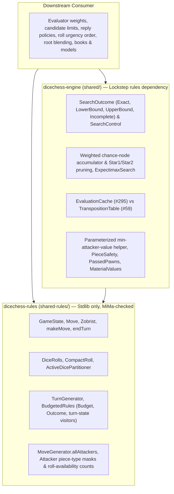

This page specifies the public Scala contracts and artifact ownership boundaries for shared full-turn traversal, bounded stochastic search outcomes, weighted chance-node accumulation, evaluation helpers, and downstream consumer adapters ([Epic #390](https://github.com/fortemate/dicechess-engine/issues/390), [Issue #391](https://github.com/fortemate/dicechess-engine/issues/391)).

The design extends the existing rules and search primitives rather than introducing a parallel rules or search hierarchy. Built-in bot defaults, binary compatibility of `dicechess-rules_3`, and the Java/Kotlin (`JvmApi`) and JavaScript (`DiceChess`, `EngineFacade`) facades remain unchanged unless a separate compatibility decision explicitly states otherwise.

---

## 1. Existing API Inventory and Remaining Gaps

All symbols below live in `dicechess.engine.search` (split across `dicechess-rules_3` and `dicechess-engine_3` without changing imports; see [Published Artifacts & Rules-Only Migration](/dicechess-engine/architecture/artifacts/)) or in `dicechess.engine.domain` / `dicechess.engine.movegen`.

| Capability | Artifact & Source Root | Completed Foundation | Reuse Point | Qualified Contract & Minimum Version |
| :--- | :--- | :--- | :--- | :--- |
| **Promotion-aware roll equivalence** | `dicechess-rules` (`shared-rules/.../search/ActiveDicePartitioner.scala`, `CompactRoll.scala`) | [#387](https://github.com/fortemate/dicechess-engine/issues/387) (`0.15.0`): 192 immutable `IArray[WeightedRoll]` tables (64 presence masks $\times$ 3 promotion modes); positive integer weights summing to `216`; `CompactRoll.Empty` preserved as forced pass; incremental `zobristKey` update in `applyToState`. | Direct roll distribution for fresh unknown rolls after `endTurn()`. | Shipped in `0.15.0` ([#387](https://github.com/fortemate/dicechess-engine/issues/387)); integrated in `ChanceNode.expand` and `ExpectimaxSearch` in the next release after `0.16.0` (`>= 0.16.1`, [#394](https://github.com/fortemate/dicechess-engine/issues/394)). |
| **Exhaustive turn-path & state enumeration** | `dicechess-rules` (`shared-rules/.../search/TurnGenerator.scala`, `PlayableDice.scala`) | `generateAllLegalTurnPaths` and `forEachLegalTurnPath`: enforces immediate king-capture legality and maximal **dice consumed** (castling = 2 dice) via packed 64-bit path buffers. | Canonical turn-legality oracle and packed path layout. | Shipped in `0.16.0` ([#392](https://github.com/fortemate/dicechess-engine/issues/392)): `TurnGenerator.forEachLegalTurnState` reuses a 2-slot intra-turn prefix cache, passes `isKingCapture` and the resulting `GameState`, and powers `MonteCarloSearch` / `MonteCarloEquity` in the next release after `0.16.0` (`>= 0.16.1`, [#405](https://github.com/fortemate/dicechess-engine/issues/405)). |
| **Work-bounded rules queries** | `dicechess-rules` (`shared-rules/.../search/BudgetedRules.scala`) | [#316](https://github.com/fortemate/dicechess-engine/issues/316), [#323](https://github.com/fortemate/dicechess-engine/issues/323) (`0.14.9`): invocation-local `Budget(limit)` with sticky exhaustion and `Outcome[+A]` (`Complete` \| `Incomplete`) over `turnPaths`, `kingCaptureRolls`, and early-exit `kingCapturePath` ([guide](/dicechess-engine/architecture/rules-budgets/)). | Canonical rules work-unit accounting and `kingCapturePath` witness traversal. | Shipped in `0.16.0` ([#392](https://github.com/fortemate/dicechess-engine/issues/392)) with strict en-passant eligibility in the next release after `0.16.0` (`>= 0.16.1`, [#430](https://github.com/fortemate/dicechess-engine/pull/430)): `BudgetedRules.visitTurnStates` and `foldTurnStates`. |
| **Stochastic expectimax & Star1/Star2** | `dicechess-engine` (`shared/.../search/ExpectimaxSearch.scala`, `ChanceNode.scala`, `SearchControl.scala`) | [#56](https://github.com/fortemate/dicechess-engine/issues/56): 2-ply and 3-ply expectimax with `LeafKey` per-chance-node deduplication, `evalBatch`, Star1 roll-by-roll cutoffs, Star2 single-reply probes, `RootRescore` bound inversion, and `deadlineNanos` checks between rolls. | Star1/Star2 bound math, `RootRescore` loss-taint handling, and `ExpectimaxConfig` / `TimeBudgetedSearch`. | Next release after `0.16.0` (`>= 0.16.1`, [#393](https://github.com/fortemate/dicechess-engine/issues/393), [#394](https://github.com/fortemate/dicechess-engine/issues/394)): `SearchOutcome`, `SearchControl`, `UtilityBounds`, `ControlledSearch`, and `ChanceNode.expand` unify 2-ply and 3-ply search. |
| **Zobrist hashing & search TT** | `dicechess-rules` (`Zobrist.scala`) & `dicechess-engine` (`TranspositionTable.scala`) | [#59](https://github.com/fortemate/dicechess-engine/issues/59): incremental 64-bit `Zobrist` hash (placement, side, castling, full `enPassant` bitboard, `dicePool`) and lockless XOR `TranspositionTable` (`TTBound`, depth, `lossTainted`, `MaxChanceKeySalt`). | Incremental `zobristHash` and subtree bound caching. | Next release after `0.16.0` (`>= 0.16.1`, [#397](https://github.com/fortemate/dicechess-engine/issues/397)): ownership, key-identity, loss-taint, concurrency, invalidation, and pre-probe cancellation boundaries relative to `EvaluationCache` — see [Invocation-local Evaluation Cache](/dicechess-engine/architecture/search/evaluation-cache/). |
| **Exact evaluation memoization** | `dicechess-engine` (`shared/.../search/EvaluationCache.scala`, [#295](https://github.com/fortemate/dicechess-engine/issues/295)) | Invocation-local `EvaluationCache` wrapping deterministic `(GameState, Color) => Int` by full `GameState.equals` + `Color`, preserving path multiplicity and RNG. | Exact post-`endTurn()` static-evaluation memoization without candidate deduplication. | Next release after `0.16.0` (`>= 0.16.1`, [#295](https://github.com/fortemate/dicechess-engine/issues/295), [#397](https://github.com/fortemate/dicechess-engine/issues/397)): kept strictly separate from `TranspositionTable` — see [Invocation-local Evaluation Cache](/dicechess-engine/architecture/search/evaluation-cache/). |
| **Attack geometry, safety & material scale** | `dicechess-rules` (`MoveGenerator.scala`, `AttackerTypes.scala`) & `dicechess-engine` (`PieceSafety.scala`, `PieceValues.scala`) | `MoveGenerator.isSquareAttacked` (boolean early-exit) and `MoveGenerator.allAttackers` (complete attacker square union; merges queens into slider masks). `PieceSafety` prices hanging non-king squares in `MaterialValues`. | `MoveGenerator.allAttackers` geometry and `DiceRolls.totalOrderedRolls` (`216`). | Next release after `0.16.0` (`>= 0.16.1`, [#395](https://github.com/fortemate/dicechess-engine/issues/395)): `AttackerTypes` (exact 6-bit type mask, `count`, `availableRolls`) and `DiceRolls.rollsShowingAnyOf` / `probabilityOfAnyOf` in `dicechess-rules_3`, `PieceValues` in `dicechess-engine_3` — see [Attacker Types & Piece Values](/dicechess-engine/architecture/search/17-attacker-types-and-piece-values/). |
| **Passed-pawn detection** | `dicechess-engine` (`shared/.../search/PassedPawns.scala`) | `PassedPawns.bitboard(state, color)`, `count`, `maxRank`, and `countAndMaxRank` over precomputed 3-file front spans. | Canonical passed-pawn bitboard detector independent of `activeColor` and `dicePool`. | Shipped since `0.11.0`; qualified in the next release after `0.16.0` (`>= 0.16.1`, [#396](https://github.com/fortemate/dicechess-engine/issues/396)): verified against an independent reference scan with a compiled generic rank-bonus adapter — see [Mobility and Passed Pawn Contracts](/dicechess-engine/architecture/search/09-mobility-and-passed-pawns/). |

---

## 2. Artifact Ownership, State Transitions, and Utility Invariants

### 2.1 Rules vs Engine Ownership

:::note
Implemented for the attack-geometry row: `AttackerTypes` and the roll-availability counts live in `dicechess-rules_3`, `PieceValues` in `dicechess-engine_3`. The implementation guide is [Attacker Types & Piece Values](/dicechess-engine/architecture/search/17-attacker-types-and-piece-values/); this section remains the reviewed contract.
:::



1. **`dicechess-rules_3` (`shared-rules/`)**:
   - Owns board/dice consequences that hold regardless of strategy: legal full-turn traversal, intra-turn prefix replay, `endTurn()` transitions, `BudgetedRules.Budget` / `Outcome`, `ActiveDicePartitioner`, exact 6-bit attacking piece-type masks (intersecting `MoveGenerator.allAttackers` with `state.pawns` through `state.kings` so queens never trigger bishop or rook bits), and exact single-roll availability counts `216 - (6 - k)^3` out of `216`.
   - Carries zero centipawn scales, heuristic evaluations, `scala.util.Random` draws, wall-clock calls, move-ordering policies, or third-party dependencies.
   - Preserves the JavaScript `./rules` subpath boundary enforced by `.mise/lib/check-npm-package-entries.mjs`: `RulesOps` and `RulesApi` must not pull `TurnGenerator`, `BudgetedRules`, `PlayableDice`, or `KingCaptureProbability` into the `./rules` chunk.
2. **`dicechess-engine_3` (`shared/`)**:
   - Owns generic search mechanics and evaluation building blocks: `SearchOutcome`, cooperative `SearchControl`, weighted chance-node accumulation and sound Star1/Star2 pruning over caller-supplied callbacks and `[vMin, vMax]` bounds, `ExpectimaxSearch`, `EvaluationCache` ([#295](https://github.com/fortemate/dicechess-engine/issues/295)), `TranspositionTable`, `PassedPawns`, `PieceSafety`, and parameterized minimum-attacker-value lookup over caller-supplied prices.
   - Keeps consumer evaluator weights, search profiles, candidate limits, selective non-exhaustive reply filters, urgency ordering, root blending parameters, opening books, and trained models outside the shared engine mechanism.

### 2.2 Canonical Turn-State Traversal and `endTurn()` Ownership (`#392`)

The two-phase discovery and replay below remains the contract of `TurnGenerator.forEachLegalTurnState`, `BudgetedRules.visitTurnStates` and `foldTurnStates`. The single-roll visitor retains two intermediate replay boards. The additive `TurnGenerator.SharedTraversal` API explicitly caches ordered prefixes across dice classes and can emit proved king captures during discovery; its cache lifetime, separate accounting and early-stop contracts are specified in [Traversal Prefixes Across Dice Classes](/dicechess-engine/architecture/search/19-shared-class-traversal/) ([#442](https://github.com/fortemate/dicechess-engine/issues/442)).

Within a turn for `mover = state.activeColor`, non-capturing path legality depends on `maxDice` — the maximum **dice consumed** achievable across the whole turn (castling consumes 2 dice; normal moves consume 1 die). Consequently, non-capturing paths cannot be emitted before `maxDice` is known for the entire turn.

1. **Phase 1 — Discovery & Budget Admission (Zero Callback Emissions)**:
   - Explores legal continuations using `MoveGenerator.generateMoves` and `state.diceAfter(move)`.
   - In `BudgetedRules`, admits `1` work unit before each `MoveGenerator.generateMoves` call and `1` work unit before examining each generated `Move`, matching `BudgetedRules.turnPaths` work accounting.
   - Buffers paths in an invocation-local packed 64-bit `Long` array (`kingCaptures` and `normalPaths` + `maxDice`).
   - If `budget.exhausted` occurs during Phase 1, **zero** visitor callbacks are invoked and traversal returns `BudgetedRules.Outcome.Incomplete(budget.used)`.
2. **Phase 2 — Shared-Prefix Replay & Canonical Emission**:
   - Emits `kingCaptures` first in `MoveGenerator` order, followed by `normalPaths` with `diceConsumed == maxDice` in `MoveGenerator` order.
   - Reuses an invocation-local 2-slot intra-turn prefix cache (`prevM0` $\rightarrow$ `s1 = state.makeMove(m0)`, `prevM1` $\rightarrow$ `s2 = s1.makeMove(m1)`). Intra-turn prefix states preserve `activeColor == mover`, `dicePool == Nil` (`GameState.makeMove(Move)` contract), and inherited opponent en-passant targets.
3. **`endTurn()` and Callback State Contract**:
   - **King capture (`isKingCapture == true`, `len` in `1..3`)**: The game ends immediately on `sLast = prefix.makeMove(m_{len-1})`. **`endTurn()` is not called.** `sLast.activeColor == mover`, `sLast.dicePool == Nil`, the captured king bitboard is empty, and `sLast` equals `path.foldLeft(state)(_.makeMove(_))` (including `zobristHash`).
   - **Normal maximal-dice turn (`isKingCapture == false`, `len` in `1..3`)**: **`endTurn()` is called once** on the final step: `afterTurn = prefix.makeMove(m_{len-1}).endTurn()`. `afterTurn.activeColor == mover.opponent`, `afterTurn.dicePool == Nil`, `fullMoveNumber` increments after Black, stale en-passant targets of `mover.opponent` are cleared, and `afterTurn` equals `path.foldLeft(state)(_.makeMove(_)).endTurn()` (including `zobristHash`). Callers pass `afterTurn` directly to evaluators, caches, and `ActiveDicePartitioner.partitionsFor(afterTurn)` without calling `endTurn()` again.
   - **Forced pass (`0` legal paths)**: Zero path callbacks are invoked; traversal completes with `emittedPaths = 0` and `totalLegalPaths = 0`. Callers advancing across a forced-pass turn apply `state.endTurn()` once at the turn boundary.
4. **Additive Scala Signatures (`shared-rules`)**:

```scala
// TurnGenerator (unbudgeted, borrowed 3-slot Array[Move] valid only during `f`):
def forEachLegalTurnState(state: GameState)(
    f: (Array[Move], Int, GameState, Boolean) => Boolean
): Int

// BudgetedRules (budgeted counterparts):
final case class TurnVisitSummary(emittedPaths: Int, totalLegalPaths: Int, stoppedEarly: Boolean)
    derives CanEqual

final case class TurnFoldResult[+A](value: A, stoppedEarly: Boolean)
    derives CanEqual

def visitTurnStates(state: GameState, budget: Budget)(
    f: (Array[Move], Int, GameState, Boolean) => Boolean
): Outcome[TurnVisitSummary]

def foldTurnStates[A](state: GameState, initial: A, budget: Budget)(
    f: (A, List[Move], GameState, Boolean) => (A, Boolean)
): Outcome[TurnFoldResult[A]]
```

Returning `false` from `f` stops emission early at caller request (for example on the first king capture or a beta cutoff) and yields `Outcome.Complete(..., stoppedEarly = true)` (for both `TurnVisitSummary` and `TurnFoldResult`), keeping caller-requested early termination distinct from `Outcome.Incomplete(used)`.

### 2.3 Probability Weights and Mandatory-Move Bound Invariant (`#394`)

:::note
Implemented: `ChanceNode` in `dicechess-engine_3` is the shared weighted chance node, and `ExpectimaxSearch` runs both depths on it. The implementation guide and fixture results are on [Weighted Chance-Node Search](/dicechess-engine/architecture/search/16-weighted-chance-node-search/); this section remains the reviewed contract.
:::

At any chance node for an upcoming unknown roll on `postEndTurnState` (`dicePool == Nil`, both kings present):

1. **Exact Probability Conservation**: `ActiveDicePartitioner.partitionsFor(postEndTurnState)` returns positive integer weights summing to `DiceRolls.totalOrderedRolls` (`216`):
   $$\sum_{i=0}^{|P|-1} w_i = 216, \quad E = \frac{1}{216} \sum_{i=0}^{|P|-1} w_i \, V(\text{class}_i)$$
2. **Forced-Pass Weight Preservation**: Both `CompactRoll.Empty` and any non-empty retained `CompactRoll` whose `rolled = entry.roll.applyToState(postEndTurnState)` produces `0` legal paths evaluate the forced-pass successor `rolled.endTurn()` with their full weight $w_i$. Neither class may be dropped or renormalized.
3. **Mandatory-Move Bound Invariant**: Whenever a roll admits at least one legal turn path, passing is **illegal** in Dice Chess and the active player must consume `maxDice` (unless capturing the king). Because a mandatory move can worsen the mover's position relative to passing, the static pass evaluation $V(\text{rolled.endTurn()})$ is **not** a valid upper bound on a MIN reply or lower bound on a MAX reply. Star1 and Star2 cutoffs may rely only on:
   - proven utility bounds $[L, U]$ enclosing every legal reply outcome at that ply, and
   - evaluated legal replies (such as a single legal Star2 probe $r_0$, proving $\min V \le V(r_0)$ at MIN or $\max V \ge V(r_0)$ at MAX).

### 2.4 Perspective and Terminal Utility Dominance (`#393`, `#394`)

1. Search windows $[\alpha, \beta]$ and chance expectations are expressed from a single declared `perspective: Color` (`MAX` when `mover == perspective`, `MIN` when `mover == perspective.opponent`).
2. Root immediate king capture short-circuits with `SearchScoring.TerminalWinScore` (`Int.MaxValue`) before pre-ranking or chance expansion.
3. Recursive chance/decision nodes require strict dominance between terminal sentinels and clamped non-terminal evaluations:
   $$\text{terminalLoss} < \text{minNonTerminal} \le \text{maxNonTerminal} < \text{terminalWin}$$
   At a MIN chance node, the pessimistic per-roll lower bound $L$ must be `terminalLoss` (not `minNonTerminal`) unless opponent king capture on unexpanded rolls has already been ruled out. When `RootRescore` blending is active, loss-tainted candidates continue to bypass blending as documented in [Expectimax Search Engine](/dicechess-engine/architecture/search/06-expectimax-search/).

---

## 3. Bounded Search Outcomes and Cooperative Cancellation (`#393`)

:::note
Implemented: `SearchOutcome`, `SearchControl`, `UtilityBounds` and the `ControlledSearch` adapter ship in `dicechess-engine_3`, and `ExpectimaxSearch` runs on them. The implementation guide, fixture results and evaluator obligations are on [Bounded Search Outcomes & Cooperative Cancellation](/dicechess-engine/architecture/search/15-search-outcomes-and-cancellation/); this section remains the reviewed contract.
:::

### 3.1 Public `SearchOutcome` Semantics

```scala
enum SearchOutcome[+A] derives CanEqual:
  case Exact(value: A, workUsed: Long)
  case LowerBound(value: A, workUsed: Long) // proven true value >= value (fail-high / > beta)
  case UpperBound(value: A, workUsed: Long) // proven true value <= value (fail-low / < alpha)
  case Incomplete(workUsed: Long)           // cancelled; carries no rankable score
```

- **No score on `Incomplete`**: An interrupted expectation has neither a valid lower bound nor a valid upper bound unless already proven before cancellation; omitting a value field prevents accidental candidate ranking or cache insertion at compile time.
- **Strict window inequalities (`< alpha`, `> beta`)**: Fail-low requires a strict upper bound $< \alpha$ and fail-high requires a strict lower bound $> \beta$, ensuring equal-valued root candidates reach `Exact` for seeded random tie-breaking.

### 3.2 Shared `SearchControl` and Cancellation Check Order

`SearchControl` combines an optional deterministic `BudgetedRules.Budget` and an optional cooperative deadline (`deadlineNanos: Long` with an injectable `clockNanos: () => Long = () => System.nanoTime()`):

1. **Latching Cancellation**: Once `Budget.exhausted` or `clockNanos() >= deadlineNanos` (a direct comparison; the subtractive idiom overflows for extreme deadlines) triggers, cancellation latches `true` for the rest of the invocation.
2. **Zero-Syscall Untimed Fast Path**: When `deadlineNanos == Long.MaxValue`, `clockNanos()` is never called.
3. **Check Points**: Checked before the first expensive operation at entry, between root candidates, between `WeightedRoll` entries at every chance node, inside nested `BudgetedRules` queries via the shared `Budget`, after indivisible batch calls, and **before cache-hit paths** (`EvaluationCache` and `TranspositionTable` lookups) so already-expired invocations deterministically return `Incomplete`.
4. **Atomic Uninterruptible Operations**: A single `MoveGenerator.generateMoves` call, a single scalar `eval(state, color)` call, and a single batched `evalBatch(states, color)` call are atomic. Neither work units nor `deadlineNanos` preempts inside an atomic call or bounds callback heap usage; hosts retain external wall-clock and memory guards where required.
5. **Fallback Ownership**: Lower-level traversal and chance-node evaluators return `Incomplete` without fabricating moves. Root `SearchAlgorithm` / `TimeBudgetedSearch` adapters own move fallback in order: (1) immediate root king capture, (2) best completed (`Exact`) root candidate, (3) pre-ranker top choice or first canonical legal path when zero candidates completed, (4) `None` only on a forced pass (`0` legal paths).

---

## 4. Determinism, Scratch, Concurrency, Cache Boundaries, and Fixtures

### 4.1 Determinism, Multiplicity, RNG, and Scratch Ownership

- **Multiplicity preservation vs state deduplication**: Commuting micro-moves (`a2a3 -> h2h3` vs `h2h3 -> a2a3`) remain separate paths in canonical traversal. `EvaluationCache` ([#295](https://github.com/fortemate/dicechess-engine/issues/295)) memoizes `(GameState, Color) => Int` without collapsing candidate paths or changing seeded tie-break probabilities; deduplicating layers (`TacticianSearch`, `LeafKey`) explicitly collapse identical post-`endTurn()` states where $\min(S) = \min(\text{distinct}(S))$.
- **Floating-point summation**: Weighted expectations sum `entry.weight.toDouble * rollValue` and divide once by `216.0`. Reordering rolls preserves exact rational expectations; fixed-order runs are bit-exact in `Double`, while caller-reordered runs compare within ULP tolerance against rational oracles.
- **RNG isolation**: `scala.util.Random` is consumed solely by root tie-breaking over completed candidates; traversal, partitioning, caches, and chance accumulation never touch RNG.
- **Scratch & concurrency**:
  - `ActiveDicePartitioner.partitionsFor` returns shared immutable `IArray[WeightedRoll]` instances; any consumer urgency reordering copies into invocation-local scratch arrays.
  - `Budget`, `SearchControl`, visitor `Array[Move]` buffers, and `EvaluationCache` are **single-invocation, single-thread** objects.
  - `SearchAlgorithm` instances are safe for concurrent independent calls when scratch state is invocation-local. `TranspositionTable` is racy-reader safe (Hyatt XOR checksum), with a single writer recommended until parallel search ([#61](https://github.com/fortemate/dicechess-engine/issues/61)) revisits publication fences; it must only be shared within a single fixed evaluator configuration and utility scale.

### 4.2 Cache Ownership Boundary: `EvaluationCache` (`#295`) vs `TranspositionTable` (`#59`, `#397`)

:::note
Implemented and verified ([#295](https://github.com/fortemate/dicechess-engine/issues/295), [#397](https://github.com/fortemate/dicechess-engine/issues/397)): `EvaluationCache` and `TranspositionTable` ship as separate helpers in `dicechess.engine.search` (`dicechess-engine_3`) with no third shared cache abstraction. See [Invocation-local Evaluation Cache](/dicechess-engine/architecture/search/evaluation-cache/) for the implementation guide and compiled boundary examples.
:::

`EvaluationCache` and `TranspositionTable` have incompatible correctness keys and remain **separate** abstractions (`#295` keeps its existing scope and owner unchanged):

| Dimension | `EvaluationCache` ([#295](https://github.com/fortemate/dicechess-engine/issues/295)) | `TranspositionTable` ([#59](https://github.com/fortemate/dicechess-engine/issues/59)) |
| :--- | :--- | :--- |
| **Function cached** | Deterministic static evaluation `(GameState, Color) => Int` | Stochastic subtree search `(GameState, depth, alpha, beta, role) => SearchOutcome[Double]` |
| **Perspective & utility scale** | Explicit `perspective: Color` in the lookup tuple `(state, perspective)`; returns raw `Int` callback score | Stated for the search's single root `perspective` on its `UtilityBounds` scale; depth-3 inner `MAX` chance nodes XOR `MaxChanceKeySalt` into the key so `MAX` and `MIN` continuations on the same board never collide |
| **Identity key** | Exact `(GameState, Color)` via `GameState.equals` (bitboards, 64-square mailbox, `flags` with `dicePool`, `castlingRights`, `halfMoveClock`, full `enPassant` bitboard, `fullMoveNumber`; excludes derived `zobristKey`) | 64-bit `Zobrist` key (piece placement, `activeColor`, `castlingRights`, full `enPassant` bitboard, canonical `dicePool`) XORed with depth-3 `MaxChanceKeySalt` (excludes `halfMoveClock` and `fullMoveNumber`) |
| **Collision & replacement** | Lossless value equality on `HashMap` buckets; no eviction during the invocation | Fixed power-of-two array (`key & mask`), depth-preferred replacement (`depth >= oldDepth` or replacing a non-exact bound on the same key), 64-bit Hyatt XOR verification (~$2^{-64}$ collision rate accepted for search bounds) |
| **Stored payload & terminal/loss-taint** | Exact `Int` score only (`SearchScoring.scorePath` short-circuits immediate king capture before touching the cache) | `(value, depth, TTBound, lossTainted)` — immediate root king capture short-circuits before probing; recursive chance nodes record `lossTainted = true` (at `terminalLoss`) when any opponent roll captures the root perspective's king so `RootRescore` never blends a loss-tainted candidate on a table hit |
| **Invalidation, memory & concurrency** | Per-invocation, single-thread `mutable.HashMap` growing with unique evaluated pairs, discarded at end of call | Caller-owned fixed primitive arrays, racy-reader safe (lockless XOR checksum, single writer recommended), reusable across moves/plies for one fixed evaluator/model/rescore scale; clear or replace on config change |
| **Cancellation & incomplete values** | Check cancellation before `apply` (including hits); failed/cancelled calls never write | Check `SearchControl.isCancelled` before lookup; `Incomplete` outcomes carry no score and never write |

### 4.3 Public Synthetic Reference-Fixture Matrix (`F1`–`F10`)

All implementation stages and the final cross-platform qualification suite (`consumer.CrossPlatformQualificationSuite`) validate against public synthetic DFEN fixtures rather than private corpora:

| Fixture ID | Synthetic DFEN | Contract Verified | Target Stages & Verification Suites |
| :--- | :--- | :--- | :--- |
| **F1** | `4k3/8/8/8/8/8/8/4K3 w - - 0 1` | King-only ADEP 4 classes (`125 + 75 + 15 + 1 = 216`) and `CompactRoll.Empty` forced-pass `endTurn()` transition. | `#392`, `#394`, `#399` (`TurnStateVisitorSuite`, `ChanceNodeSuite`, `CrossPlatformQualificationSuite`) |
| **F2** | `k7/4P3/8/8/8/8/8/4K3 w - - 0 1 PNN` | Rank-7 single-pawn promotion followed by two knight moves in the same turn; ADEP promotion retention. | `#392`, `#394`, `#399` (`TurnStateVisitorSuite`, `ChanceNodeSuite`, `JvmApiSmokeCheck`, `CrossPlatformQualificationSuite`) |
| **F3** | `k7/8/4P3/8/8/8/8/4K3 w - - 0 1 PPQ` | Rank-6 two-pawn promotion + promoted queen move; 3-step intra-turn shared-prefix reuse. | `#392`, `#394`, `#399` (`TurnStateVisitorSuite`, `ChanceNodeSuite`, `CrossPlatformQualificationSuite`) |
| **F4** | `4k3/8/8/8/8/p7/P7/R3K3 w - - 0 1 PPP` | Non-empty roll (`PPP`) with blocked piece yielding `0` legal paths; forced-pass mass preserved; root returns `None`. | `#392`, `#393`, `#394`, `#398`, `#399` (`TurnStateVisitorSuite`, `SearchControlSuite`, `ChanceNodeSuite`, `StagedAdoptionParitySuite`, `CrossPlatformQualificationSuite`) |
| **F5** | `4k3/8/8/8/8/8/P7/R3K2R w KQ - 0 1 KR` | Castling consumes 2 dice (`K`+`R`), filtering out 1-die branches under maximal-dice rule. | `#392`, `#398`, `#399` (`TurnStateVisitorSuite`, `StagedAdoptionParitySuite`, `CrossPlatformQualificationSuite`) |
| **F6** | `4k3/8/8/3pP3/8/8/8/R3K3 w Q d6 0 1 RP` | Inherited `d6` en-passant target stays capturable across micro-moves and clears only at `endTurn()`. | `#392`, `#397`, `#398`, `#399` (`TurnStateVisitorSuite`, `EvaluationCacheIntegrationSuite`, `StagedAdoptionParitySuite`, `CrossPlatformQualificationSuite`) |
| **F7** | `8/8/8/2k5/8/1N6/2P5/K7 w - - 0 1 NPP` | Early 1-die king capture (`Nb3xc5`) emitted first with `isKingCapture = true` and **without** `endTurn()`; exact `Knight` attacker bit (`91 / 216`). | `#392`, `#393`, `#394`, `#395`, `#398`, `#399` (`TurnStateVisitorSuite`, `AttackerTypesSuite`, `RulesOnlyConsumerSpec`, `StagedAdoptionParitySuite`, `CrossPlatformQualificationSuite`) |
| **F8** | `4k3/8/8/8/8/8/P6P/4K3 w - - 0 1 PP` | Commuting pawn pushes reach equal post-`endTurn()` `GameState`; multiplicity vs `LeafKey` deduplication; 2 passed pawns. | `#392`, `#295`, `#394`, `#396`, `#397`, `#398`, `#399` (`TurnStateVisitorSuite`, `PassedPawnsContractSpec`, `EvaluationCacheIntegrationSuite`, `StagedAdoptionParitySuite`, `CrossPlatformQualificationSuite`) |
| **F9** | `4k3/8/8/8/3r4/2P5/8/4K3 b - - 0 1 R` | Mandatory disadvantageous move cases proving static pass score is not a sound Star bound. | `#394`, `#398`, `#399` (`ChanceNodeSuite`, `StagedAdoptionParitySuite`, `CrossPlatformQualificationSuite`) |
| **F10** | `r1bqkbnr/pppp1ppp/2n5/4p3/2B1P3/5N2/PPPP1PPP/RNBQK2R w KQkq - 2 3` | Exact `Budget(0)`, `Budget(1)`, `Budget(exact - 1)` vs `Budget(exact)` and pre-cache-hit clock cancellation. | `#392`, `#393`, `#394`, `#397`, `#398`, `#399` (`TurnStateVisitorSuite`, `ExpectimaxSearchControlSuite`, `EvaluationCacheIntegrationSuite`, `StagedAdoptionParitySuite`, `CrossPlatformQualificationSuite`) |

---

## 5. Compatibility, Qualification Matrix, and Remaining Limitations

### 5.1 Compatibility Rules

- **`dicechess-rules_3` binary compatibility**: Every addition in `shared-rules/` is strictly additive against `RulesMimaBaseline` (`rulesJVM/assertRulesBinaryCompatible`) with zero MiMa exclusions and zero third-party dependencies (`rules-smoke/`).
- **Facade stability**: `JvmApi`, `DiceChess`, `EngineFacade`, `RulesApi` (`./rules`), `js/dicechess-engine.d.ts`, and `js/dicechess-rules.d.ts` remain unchanged.
- **Serving & benchmark separation**: Fixed-work parity against exhaustive oracles (using a deterministic `Budget` and `SearchControl` with `deadlineNanos = Long.MaxValue`) validates correctness independently of wall-clock throughput or playing-strength claims.

### 5.2 Staged Adoption Sequence (`#392`–`#399`)

1. **Wave 1 — Leaf & Feature Primitives**: Qualify `PassedPawns.bitboard` ([#396](https://github.com/fortemate/dicechess-engine/issues/396), done — see [Mobility and Passed Pawn Contracts](/dicechess-engine/architecture/search/09-mobility-and-passed-pawns/)), add exact attacker-type mask / roll-availability / parameterized minimum-value helpers ([#395](https://github.com/fortemate/dicechess-engine/issues/395), done — see [Attacker Types & Piece Values](/dicechess-engine/architecture/search/17-attacker-types-and-piece-values/)), implement `EvaluationCache` ([#295](https://github.com/fortemate/dicechess-engine/issues/295), done), and publish compiled cache-boundary examples ([#397](https://github.com/fortemate/dicechess-engine/issues/397), done — see [Invocation-local Evaluation Cache](/dicechess-engine/architecture/search/evaluation-cache/)).
2. **Wave 2 — Canonical Traversal & Bounded Outcomes**: Ship shared-prefix resulting-state visitors in `TurnGenerator` and `BudgetedRules` ([#392](https://github.com/fortemate/dicechess-engine/issues/392), done) and `SearchOutcome` / `SearchControl` ([#393](https://github.com/fortemate/dicechess-engine/issues/393), done — see [Bounded Search Outcomes & Cooperative Cancellation](/dicechess-engine/architecture/search/15-search-outcomes-and-cancellation/)).
3. **Wave 3 — Shared Weighted Chance-Node Search**: Extract callback-based weighted chance-node accumulation and sound Star1/Star2 pruning over `ActiveDicePartitioner` partitions and reconcile `ExpectimaxSearch` ([#394](https://github.com/fortemate/dicechess-engine/issues/394), done — see [Weighted Chance-Node Search](/dicechess-engine/architecture/search/16-weighted-chance-node-search/)).
4. **Wave 4 — Incremental Downstream Migration**: The downstream adoption tracked by [#398](https://github.com/fortemate/dicechess-engine/issues/398) and [Epic #390](https://github.com/fortemate/dicechess-engine/issues/390) is complete against published engine/rules `0.18.2`. Duplicate traversal and chance-node mechanisms were replaced after behavior and compatibility qualification, with accepted differences documented in the owning consumer repository. Private evaluators, weights, profiles, books, and models remain consumer-owned. The [Staged Downstream Adoption Guide](/dicechess-engine/architecture/search/18-staged-downstream-adoption/) retains the reusable migration procedure.
5. **Wave 5 — Cross-Platform Qualification**: Integrated JVM, Scala.js, WasmGC, `rules-smoke`, MiMa, JMH, Java/JS facade, Scaladoc, and docs-site verification across the combined contracts ([#399](https://github.com/fortemate/dicechess-engine/issues/399), done).

### 5.3 Cross-Platform Compatibility & Sub-Issue Reconciliation Matrix (`#399`)

All 12 sub-issues of [Epic #390](https://github.com/fortemate/dicechess-engine/issues/390) are reconciled below across supported runtimes (`rootJVM`, `rootJS`, `rootWasm`, `rulesJVM`, `rulesJS`, `rulesSmoke`):

| Sub-Issue | Scope | Owning Artifact | Minimum Version | Cross-Platform & Boundary Verification |
| :--- | :--- | :--- | :--- | :--- |
| [#387](https://github.com/fortemate/dicechess-engine/issues/387) | `ActiveDicePartitioner`, `CompactRoll` (192 tables) | `dicechess-rules_3` | `0.15.0` | `ActiveDicePartitionerSuite`, `ActiveDicePartitionerCrossPlatformSuite`, `RulesOnlyConsumerSpec` |
| [#391](https://github.com/fortemate/dicechess-engine/issues/391) | Shared traversal & stochastic-search contracts | Docs (`14-traversal-and-search-contracts.md`) | `0.16.0` | `sbt apiDocs/doc`, `mise run docs:build` |
| [#392](https://github.com/fortemate/dicechess-engine/issues/392) | `TurnGenerator.forEachLegalTurnState`, `BudgetedRules.visitTurnStates` / `foldTurnStates` | `dicechess-rules_3` | `0.16.0` (strict EP in next release after `0.16.0` (`>= 0.16.1`), [#430](https://github.com/fortemate/dicechess-engine/pull/430)) | `TurnStateVisitorSuite`, `BudgetedRulesEnPassantEligibilitySuite`, `RulesOnlyConsumerSpec` |
| [#405](https://github.com/fortemate/dicechess-engine/issues/405) | `MonteCarloSearch` & `MonteCarloEquity` canonical turn visitor rollout | `dicechess-engine_3` | Next release after `0.16.0` (`>= 0.16.1`) | `MonteCarloSearchSuite`, `MonteCarloEquitySpec` |
| [#393](https://github.com/fortemate/dicechess-engine/issues/393) | `SearchOutcome`, `SearchControl`, `UtilityBounds`, `ControlledSearch` | `dicechess-engine_3` | Next release after `0.16.0` (`>= 0.16.1`) | `SearchOutcomeSuite`, `SearchControlSuite`, `UtilityBoundsSuite`, `ExpectimaxSearchControlSuite` |
| [#394](https://github.com/fortemate/dicechess-engine/issues/394) | `ChanceNode.expand`, `ChanceNode.Policy`, unified 2/3-ply `ExpectimaxSearch` | `dicechess-engine_3` | Next release after `0.16.0` (`>= 0.16.1`) | `ChanceNodeSuite`, `ChanceNodeConcurrencySpec`, `ExpectimaxDepthThreeSpec` |
| [#395](https://github.com/fortemate/dicechess-engine/issues/395) | `AttackerTypes`, `DiceRolls.rollsShowingAnyOf` (`rules`); `PieceValues` (`engine`) | `dicechess-rules_3` & `dicechess-engine_3` | Next release after `0.16.0` (`>= 0.16.1`) | `AttackerTypesSuite`, `AttackerTypesPropertySpec`, `PieceValuesSpec`, `RulesOnlyConsumerSpec` |
| [#396](https://github.com/fortemate/dicechess-engine/issues/396) | Qualified `PassedPawns.bitboard` & generic rank-bonus adapter | `dicechess-engine_3` | Shipped `0.11.0`; qualified in next release after `0.16.0` (`>= 0.16.1`) | `PassedPawnsSpec`, `PassedPawnsContractSpec` |
| [#295](https://github.com/fortemate/dicechess-engine/issues/295) | Invocation-local `EvaluationCache` | `dicechess-engine_3` | Next release after `0.16.0` (`>= 0.16.1`) | `EvaluationCacheSuite`, `EvaluationCacheBenchmark` |
| [#397](https://github.com/fortemate/dicechess-engine/issues/397) | `EvaluationCache` vs `TranspositionTable` ownership & key boundaries | `dicechess-engine_3` | Next release after `0.16.0` (`>= 0.16.1`) | `EvaluationCacheIntegrationSuite`, `TranspositionTableSpec` |
| [#398](https://github.com/fortemate/dicechess-engine/issues/398) | Staged downstream adoption guide & external parity recipes | `dicechess-engine_3` & Docs | Next release after `0.16.0` (`>= 0.16.1`) | `StagedAdoptionParitySuite`, `RulesOnlyConsumerSpec`, `.mise/lib/check-npm-package-entries.mjs` |
| [#399](https://github.com/fortemate/dicechess-engine/issues/399) | Integrated `F1`–`F10` cross-platform qualification, JMH evidence & limitations | All targets | Next release after `0.16.0` (`>= 0.16.1`) | `CrossPlatformQualificationSuite` (JVM + JS + Wasm), `JvmApiSmokeSpec` (Java), `JsApiSpec` (JS) |

### 5.4 Reproducible JMH Hot-Path Evidence (`#399`)

Reproduce the hot-path work, latency, and allocation measurements on JVM (OpenJDK 25) with:

```bash
mise exec -- sbt 'benchmark/Jmh/run -wi 1 -i 2 -f 1 -r 500ms -w 500ms -bm avgt -prof gc TurnGeneratorBenchmark.(replayAllLegalTurnPaths|forEachLegalTurnState) BudgetedRulesBenchmark AttackerTypesBenchmark EvaluationCacheBenchmark ExpectimaxSearchBenchmark'
```

Each benchmark isolates a specific structural mechanism and exposes auxiliary work or allocation counters alongside average time (`-prof gc`):

| Benchmark & Parameter | Baseline / Reference Method | Shared Primitive Method | Structural Mechanism & Auxiliary Counters |
| :--- | :--- | :--- | :--- |
| `TurnGeneratorBenchmark` (`kiwipete`, `dicePool = 1,2` and `1,2,3`) | `replayAllLegalTurnPaths` (path list + full replay per path) | `forEachLegalTurnState` (single-roll visitor with two replay slots) | Buffers packed paths during discovery, then reuses 1st- and 2nd-step `makeMove` states during replay and borrows a 3-slot `Array[Move]` instead of allocating per-path `List[Move]` instances. |
| `BudgetedRulesBenchmark` (`endgame`, `workLimit`) | `turnPaths` (budgeted path lists) | `visitTurnStates` (budgeted resulting-state visitor) | Admits Phase 1 discovery against `Budget` before emitting post-`endTurn()` `GameState` entries with shared-prefix reuse. |
| `SharedClassTraversalBenchmark` (`sparse`, `all-types`, `castling`, `promotion`, `en-passant`, `capture`) | Independent per-class `BudgetedRules.visitTurnStates`, full and stop-first | One `SharedTraversal` across classes, full and stop-first | Reports generation, edge examinations, discovery/result transitions, replay transitions, result counts and forced passes; use `-prof gc` for allocation. [Accounting and reproduction guide](/dicechess-engine/architecture/search/19-shared-class-traversal/). |
| `AttackerTypesBenchmark` (`initial`, `kiwipete`, `endgame`) | `allAttackers` (attacker square bitboard) | `typeMask`, `availableRolls`, `cheapestAttacker` | Adds six piece-type bitboard intersections, a `bitCount` + table-free cube `216 - (6 - k)^3`, and `PieceValues.minimumOrElse` without heap allocation. |
| `EvaluationCacheBenchmark` (`repeated` or `unique` batches; `aggressive` or `cheap` callback) | `uncached` (direct callback), `legacyTupleCache` (tuple-key map) | `cached` (scalar fingerprint, exact state/perspective equality) | A fresh cache scores the same 32-state batch; normalize `evaluatorCalls`, `cacheHits` and `entries` by `batches` to compare memoization work. |
| `ExpectimaxSearchBenchmark` (`searchDepth = 2` and `3`, cold TT) | `coldTree` (`SearchControl.Unbounded`) | `coldTreeBudgeted` (ample work budget), `coldTreeTimed` (far-future deadline) | Compares the same complete tree with untimed, work-budgeted and real-clock cancellation checks under `-prof gc`; setup verifies timed/untimed result parity. |

Measured latency, allocation-rate, and cost-ratio verdicts are retained in the private knowledge base (the `#399` cross-platform qualification benchmark evidence page) under the repository's publication boundary (`dc-shared:publication`). Fixed-work parity is proven by the cross-platform test suites; no claim about timed throughput or playing strength is inferred from primitive extraction.

### 5.5 Explicit Accounting of Remaining Limitations & Deferred Scope (`#399`)

1. **Cooperative (non-preemptive) cancellation within atomic calls**: work-budget exhaustion is checked before generation and micro-move admissions. `SearchControl` is checked between root candidates and dice classes, after batch evaluator calls, and before cache lookups. The Expectimax reply adapter checks a deadline at class entry and amortizes real-clock reads across at most 64 internal traversal cancellation polls; deterministic work-budget checks remain exact. Neither `Budget` nor `deadlineNanos` preempts inside a single piece generator, scalar `eval`, or `evalBatch` invocation, and neither bounds heap allocations inside caller-supplied callbacks. Hosts running untrusted or expensive evaluators must retain external wall-clock and memory supervision.
2. **Single-invocation, single-thread scratch state**: `BudgetedRules.Budget`, `SearchControl`, `EvaluationCache`, and the borrowed 3-slot `Array[Move]` buffer in `TurnGenerator.forEachLegalTurnState` / `BudgetedRules.visitTurnStates` are single-invocation, single-thread objects. Concurrent searches are supported by isolating these per invocation (`ChanceNodeConcurrencySpec`, `CrossPlatformQualificationSuite`). Lockless multi-writer parallel search sharing a single `TranspositionTable` with explicit publication fences remains deferred to [#61](https://github.com/fortemate/dicechess-engine/issues/61).
3. **Strict separation of `EvaluationCache` and `TranspositionTable`**: `EvaluationCache` (`(GameState, Color)` via `GameState.equals`, exact `Int` scores) and `TranspositionTable` (64-bit `Zobrist` XOR `MaxChanceKeySalt`, `(value, depth, TTBound, lossTainted)`) solve distinct problems with incompatible keys and invalidation lifecycles ([#397](https://github.com/fortemate/dicechess-engine/issues/397)). They must not be merged into a shared cache.
4. **Consumer ownership and release authority**: The downstream migration tracked by [#398](https://github.com/fortemate/dicechess-engine/issues/398) is complete against published engine/rules `0.18.2`. Consumer repositories retain ownership of private evaluator weights, search profiles, candidate limits, selective reply filters, urgency ordering, root blending, opening books, and models. Future consumers can follow the [Staged Downstream Adoption Guide](/dicechess-engine/architecture/search/18-staged-downstream-adoption/). Maven Central and npm publication remains a separate human-only action (`release.yaml` / `mise run release:prepare`).
