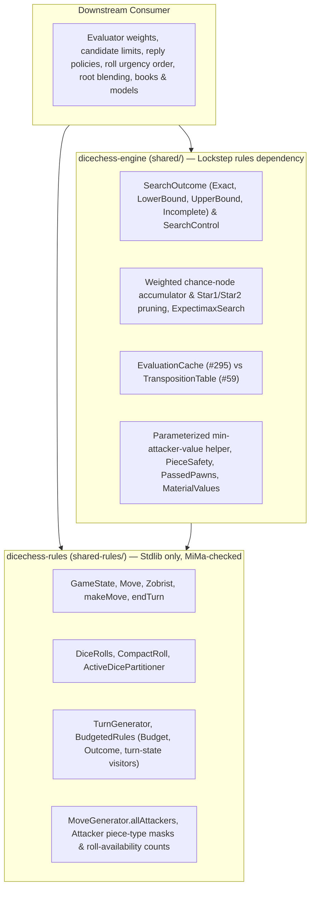

This page specifies the public Scala contracts and artifact ownership boundaries for shared full-turn traversal, bounded stochastic search outcomes, weighted chance-node accumulation, evaluation helpers, and downstream consumer adapters ([Epic #390](https://github.com/fortemate/dicechess-engine/issues/390), [Issue #391](https://github.com/fortemate/dicechess-engine/issues/391)).

The design extends the existing rules and search primitives rather than introducing a parallel rules or search hierarchy. Built-in bot defaults, binary compatibility of `dicechess-rules_3`, and the Java/Kotlin (`JvmApi`) and JavaScript (`DiceChess`, `EngineFacade`) facades remain unchanged unless a separate compatibility decision explicitly states otherwise.

---

## 1. Existing API Inventory and Remaining Gaps

All symbols below live in `dicechess.engine.search` (split across `dicechess-rules_3` and `dicechess-engine_3` without changing imports; see [Published Artifacts & Rules-Only Migration](/dicechess-engine/architecture/artifacts/)) or in `dicechess.engine.domain` / `dicechess.engine.movegen`.

| Capability | Artifact & Source Root | Completed Foundation | Reuse Point | Remaining Gap & Target Stage |
| :--- | :--- | :--- | :--- | :--- |
| **Promotion-aware roll equivalence** | `dicechess-rules` (`shared-rules/.../search/ActiveDicePartitioner.scala`, `CompactRoll.scala`) | [#387](https://github.com/fortemate/dicechess-engine/issues/387) (`0.15.0`): 192 immutable `IArray[WeightedRoll]` tables (64 presence masks $\times$ 3 promotion modes); positive integer weights summing to `216`; `CompactRoll.Empty` preserved as forced pass; incremental `zobristKey` update in `applyToState`. | Direct roll distribution for fresh unknown rolls after `endTurn()`. | `ExpectimaxSearch` still iterates the 56 unconditional rolls in `DiceRolls.byWeightDescending` and exposes no callback-driven weighted chance-node accumulator ([#394](https://github.com/fortemate/dicechess-engine/issues/394)). |
| **Exhaustive turn-path enumeration** | `dicechess-rules` (`shared-rules/.../search/TurnGenerator.scala`, `PlayableDice.scala`) | `generateAllLegalTurnPaths` and `forEachLegalTurnPath`: enforces immediate king-capture legality and maximal **dice consumed** (castling = 2 dice) via packed 64-bit path buffers. | Canonical turn-legality oracle and packed path layout. | `forEachLegalTurnPath` is unbudgeted, omits `isKingCapture` and the resulting `GameState`, cannot stop early on caller request, and forces callers to replay shared micro-move prefixes ([#392](https://github.com/fortemate/dicechess-engine/issues/392)). |
| **Work-bounded rules queries** | `dicechess-rules` (`shared-rules/.../search/BudgetedRules.scala`) | [#316](https://github.com/fortemate/dicechess-engine/issues/316), [#323](https://github.com/fortemate/dicechess-engine/issues/323): invocation-local `Budget(limit)` with sticky exhaustion and `Outcome[+A]` (`Complete` \| `Incomplete`) over `turnPaths`, `kingCaptureRolls`, and early-exit `kingCapturePath` ([guide](/dicechess-engine/architecture/rules-budgets/)). | Canonical rules work-unit accounting and `kingCapturePath` witness traversal. | `turnPaths` materializes `List[List[Move]]` without resulting `GameState` values; no budgeted visitor/fold reuses shared micro-move prefixes ([#392](https://github.com/fortemate/dicechess-engine/issues/392)). |
| **Stochastic expectimax & Star1/Star2** | `dicechess-engine` (`shared/.../search/ExpectimaxSearch.scala`, `TimeBudgetedSearch.scala`) | [#56](https://github.com/fortemate/dicechess-engine/issues/56): 2-ply and 3-ply expectimax with `LeafKey` per-chance-node deduplication, `evalBatch`, Star1 roll-by-roll cutoffs, Star2 single-reply probes, `RootRescore` bound inversion, and `deadlineNanos` checks between rolls. | Star1/Star2 bound math, `RootRescore` loss-taint handling, and `ExpectimaxConfig` / `TimeBudgetedSearch`. | Internal node result types (`ChanceNodeResult`, `RecursiveNodeResult`) are `private` and carry dummy numeric values even when aborted. 2-ply and 3-ply loops are duplicated, coupled to `evalBatch` and fixed `[-10^9, 10001]` bounds, and unavailable to callback-based consumers ([#393](https://github.com/fortemate/dicechess-engine/issues/393), [#394](https://github.com/fortemate/dicechess-engine/issues/394)). |
| **Zobrist hashing & search TT** | `dicechess-rules` (`Zobrist.scala`) & `dicechess-engine` (`TranspositionTable.scala`) | [#59](https://github.com/fortemate/dicechess-engine/issues/59): incremental 64-bit `Zobrist` hash (placement, side, castling, full `enPassant` bitboard, `dicePool`) and lockless XOR `TranspositionTable` (`TTBound`, depth, `lossTainted`, `MaxChanceKeySalt`). | Incremental `zobristHash` and subtree bound caching. | Ownership and invalidation boundaries relative to exact `(GameState, Color)` evaluation memoization need an explicit specification ([#397](https://github.com/fortemate/dicechess-engine/issues/397)). |
| **Exact evaluation memoization** | `dicechess-engine` (`shared/.../search/`, planned [#295](https://github.com/fortemate/dicechess-engine/issues/295)) | Planned invocation-local `EvaluationCache` wrapping deterministic `(GameState, Color) => Int` by full `GameState.equals` + `Color`, preserving path multiplicity and RNG. | Exact post-`endTurn()` static-evaluation memoization without candidate deduplication. | Keep [#295](https://github.com/fortemate/dicechess-engine/issues/295) scope and owner unchanged; separate cleanly from `TranspositionTable` ([#397](https://github.com/fortemate/dicechess-engine/issues/397)). |
| **Attack geometry, safety & material scale** | `dicechess-rules` (`MoveGenerator.scala`, `KingCaptureProbability.scala`) & `dicechess-engine` (`PieceSafety.scala`, `MaterialValues.scala`) | `MoveGenerator.isSquareAttacked` (boolean early-exit) and `MoveGenerator.allAttackers` (complete attacker square union; merges queens into slider masks). `PieceSafety` prices hanging non-king squares in `MaterialValues`. | `MoveGenerator.allAttackers` geometry and `DiceRolls.totalOrderedRolls` (`216`). | Missing public helpers for exact attacking piece-type masks/counts, single-roll dice-availability probability, and minimum supplied attacker value under arbitrary non-monotone price tables ([#395](https://github.com/fortemate/dicechess-engine/issues/395)). |
| **Passed-pawn detection** | `dicechess-engine` (`shared/.../search/PassedPawns.scala`) | `PassedPawns.bitboard(state, color)`, `count`, `maxRank`, and `countAndMaxRank` over precomputed 3-file front spans. | Canonical passed-pawn bitboard detector independent of `activeColor` and `dicePool`. | Needs independent reference-scan property qualification and a documented generic rank-bonus adapter recipe ([#396](https://github.com/fortemate/dicechess-engine/issues/396)). |

---

## 2. Artifact Ownership, State Transitions, and Utility Invariants

### 2.1 Rules vs Engine Ownership



1. **`dicechess-rules_3` (`shared-rules/`)**:
   - Owns board/dice consequences that hold regardless of strategy: legal full-turn traversal, intra-turn prefix replay, `endTurn()` transitions, `BudgetedRules.Budget` / `Outcome`, `ActiveDicePartitioner`, exact 6-bit attacking piece-type masks (intersecting `MoveGenerator.allAttackers` with `state.pawns` through `state.kings` so queens never trigger bishop or rook bits), and exact single-roll availability counts `216 - (6 - k)^3` out of `216`.
   - Carries zero centipawn scales, heuristic evaluations, `scala.util.Random` draws, wall-clock calls, move-ordering policies, or third-party dependencies.
   - Preserves the JavaScript `./rules` subpath boundary enforced by `.mise/lib/check-npm-package-entries.mjs`: `RulesOps` and `RulesApi` must not pull `TurnGenerator`, `BudgetedRules`, `PlayableDice`, or `KingCaptureProbability` into the `./rules` chunk.
2. **`dicechess-engine_3` (`shared/`)**:
   - Owns generic search mechanics and evaluation building blocks: `SearchOutcome`, cooperative `SearchControl`, weighted chance-node accumulation and sound Star1/Star2 pruning over caller-supplied callbacks and `[vMin, vMax]` bounds, `ExpectimaxSearch`, `EvaluationCache` ([#295](https://github.com/fortemate/dicechess-engine/issues/295)), `TranspositionTable`, `PassedPawns`, `PieceSafety`, and parameterized minimum-attacker-value lookup over caller-supplied prices.
   - Keeps consumer evaluator weights, search profiles, candidate limits, selective non-exhaustive reply filters, urgency ordering, root blending parameters, opening books, and trained models outside the shared engine mechanism.

### 2.2 Canonical Turn-State Traversal and `endTurn()` Ownership (`#392`)

Within a turn for `mover = state.activeColor`, non-capturing path legality depends on `maxDice` — the maximum **dice consumed** achievable across the whole turn (castling consumes 2 dice; normal moves consume 1 die). Consequently, non-capturing paths cannot be emitted before `maxDice` is known for the entire turn.

1. **Phase 1 — Discovery & Budget Admission (Zero Callback Emissions)**:
   - Explores legal continuations using `MoveGenerator.generateMoves` and `state.diceAfter(move)`.
   - In `BudgetedRules`, admits `1` work unit before each `MoveGenerator.generateMoves` call and `1` work unit before examining each generated `Move`, matching `BudgetedRules.turnPaths` work accounting.
   - Buffers paths in an invocation-local packed 64-bit `Long` array (`kingCaptures` and `normalPaths` + `maxDice`).
   - If `budget.exhausted` occurs during Phase 1, **zero** visitor callbacks are invoked and traversal returns `BudgetedRules.Outcome.Incomplete(budget.used)`.
2. **Phase 2 — Shared-Prefix Replay & Canonical Emission**:
   - Emits `kingCaptures` first in `MoveGenerator` order, followed by `normalPaths` with `diceConsumed == maxDice` in `MoveGenerator` order.
   - Reuses an invocation-local 2-slot intra-turn prefix cache (`prevM0` $\rightarrow$ `s1 = state.makeMove(m0)`, `prevM1` $\rightarrow$ `s2 = s1.makeMove(m1)`). Intra-turn prefix states preserve `activeColor == mover`, `dicePool == Nil` (`GameState.makeMove(Move)` contract), and inherited opponent en-passant targets.
3. **`endTurn()` and Callback State Contract**:
   - **King capture (`isKingCapture == true`, `len` in `1..3`)**: The game ends immediately on `sLast = prefix.makeMove(m_{len-1})`. **`endTurn()` is not called.** `sLast.activeColor == mover`, `sLast.dicePool == Nil`, the captured king bitboard is empty, and `sLast` equals `path.foldLeft(state)(_.makeMove(_))` (including `zobristHash`).
   - **Normal maximal-dice turn (`isKingCapture == false`, `len` in `1..3`)**: **`endTurn()` is called once** on the final step: `afterTurn = prefix.makeMove(m_{len-1}).endTurn()`. `afterTurn.activeColor == mover.opponent`, `afterTurn.dicePool == Nil`, `fullMoveNumber` increments after Black, stale en-passant targets of `mover.opponent` are cleared, and `afterTurn` equals `path.foldLeft(state)(_.makeMove(_)).endTurn()` (including `zobristHash`). Callers pass `afterTurn` directly to evaluators, caches, and `ActiveDicePartitioner.partitionsFor(afterTurn)` without calling `endTurn()` again.
   - **Forced pass (`0` legal paths)**: Zero path callbacks are invoked; traversal completes with `emittedPaths = 0` and `totalLegalPaths = 0`. Callers advancing across a forced-pass turn apply `state.endTurn()` once at the turn boundary.
4. **Additive Scala Signatures (`shared-rules`)**:

```scala
// TurnGenerator (unbudgeted, borrowed 3-slot Array[Move] valid only during `f`):
def forEachLegalTurnState(state: GameState)(
    f: (Array[Move], Int, GameState, Boolean) => Boolean
): Int

// BudgetedRules (budgeted counterparts):
final case class TurnVisitSummary(emittedPaths: Int, totalLegalPaths: Int, stoppedEarly: Boolean)
    derives CanEqual

final case class TurnFoldResult[+A](value: A, stoppedEarly: Boolean)
    derives CanEqual

def visitTurnStates(state: GameState, budget: Budget)(
    f: (Array[Move], Int, GameState, Boolean) => Boolean
): Outcome[TurnVisitSummary]

def foldTurnStates[A](state: GameState, initial: A, budget: Budget)(
    f: (A, List[Move], GameState, Boolean) => (A, Boolean)
): Outcome[TurnFoldResult[A]]
```

Returning `false` from `f` stops emission early at caller request (for example on the first king capture or a beta cutoff) and yields `Outcome.Complete(..., stoppedEarly = true)` (for both `TurnVisitSummary` and `TurnFoldResult`), keeping caller-requested early termination distinct from `Outcome.Incomplete(used)`.

### 2.3 Probability Weights and Mandatory-Move Bound Invariant (`#394`)

At any chance node for an upcoming unknown roll on `postEndTurnState` (`dicePool == Nil`, both kings present):

1. **Exact Probability Conservation**: `ActiveDicePartitioner.partitionsFor(postEndTurnState)` returns positive integer weights summing to `DiceRolls.totalOrderedRolls` (`216`):
   $$\sum_{i=0}^{|P|-1} w_i = 216, \quad E = \frac{1}{216} \sum_{i=0}^{|P|-1} w_i \, V(\text{class}_i)$$
2. **Forced-Pass Weight Preservation**: Both `CompactRoll.Empty` and any non-empty retained `CompactRoll` whose `rolled = entry.roll.applyToState(postEndTurnState)` produces `0` legal paths evaluate the forced-pass successor `rolled.endTurn()` with their full weight $w_i$. Neither class may be dropped or renormalized.
3. **Mandatory-Move Bound Invariant**: Whenever a roll admits at least one legal turn path, passing is **illegal** in Dice Chess and the active player must consume `maxDice` (unless capturing the king). Because a mandatory move can worsen the mover's position relative to passing, the static pass evaluation $V(\text{rolled.endTurn()})$ is **not** a valid upper bound on a MIN reply or lower bound on a MAX reply. Star1 and Star2 cutoffs may rely only on:
   - proven utility bounds $[L, U]$ enclosing every legal reply outcome at that ply, and
   - evaluated legal replies (such as a single legal Star2 probe $r_0$, proving $\min V \le V(r_0)$ at MIN or $\max V \ge V(r_0)$ at MAX).

### 2.4 Perspective and Terminal Utility Dominance (`#393`, `#394`)

1. Search windows $[\alpha, \beta]$ and chance expectations are expressed from a single declared `perspective: Color` (`MAX` when `mover == perspective`, `MIN` when `mover == perspective.opponent`).
2. Root immediate king capture short-circuits with `SearchScoring.TerminalWinScore` (`Int.MaxValue`) before pre-ranking or chance expansion.
3. Recursive chance/decision nodes require strict dominance between terminal sentinels and clamped non-terminal evaluations:
   $$\text{terminalLoss} < \text{minNonTerminal} \le \text{maxNonTerminal} < \text{terminalWin}$$
   At a MIN chance node, the pessimistic per-roll lower bound $L$ must be `terminalLoss` (not `minNonTerminal`) unless opponent king capture on unexpanded rolls has already been ruled out. When `RootRescore` blending is active, loss-tainted candidates continue to bypass blending as documented in [Expectimax Search Engine](/dicechess-engine/architecture/search/06-expectimax-search/).

---

## 3. Bounded Search Outcomes and Cooperative Cancellation (`#393`)

:::note
Implemented: `SearchOutcome`, `SearchControl`, `UtilityBounds` and the `ControlledSearch` adapter ship in `dicechess-engine_3`, and `ExpectimaxSearch` runs on them. The implementation guide, fixture results and evaluator obligations are on [Bounded Search Outcomes & Cooperative Cancellation](/dicechess-engine/architecture/search/15-search-outcomes-and-cancellation/); this section remains the reviewed contract.
:::

### 3.1 Public `SearchOutcome` Semantics

```scala
enum SearchOutcome[+A] derives CanEqual:
  case Exact(value: A, workUsed: Long)
  case LowerBound(value: A, workUsed: Long) // proven true value >= value (fail-high / > beta)
  case UpperBound(value: A, workUsed: Long) // proven true value <= value (fail-low / < alpha)
  case Incomplete(workUsed: Long)           // cancelled; carries no rankable score
```

- **No score on `Incomplete`**: An interrupted expectation has neither a valid lower bound nor a valid upper bound unless already proven before cancellation; omitting a value field prevents accidental candidate ranking or cache insertion at compile time.
- **Strict window inequalities (`< alpha`, `> beta`)**: Fail-low requires a strict upper bound $< \alpha$ and fail-high requires a strict lower bound $> \beta$, ensuring equal-valued root candidates reach `Exact` for seeded random tie-breaking.

### 3.2 Shared `SearchControl` and Cancellation Check Order

`SearchControl` combines an optional deterministic `BudgetedRules.Budget` and an optional cooperative deadline (`deadlineNanos: Long` with an injectable `clockNanos: () => Long = () => System.nanoTime()`):

1. **Latching Cancellation**: Once `Budget.exhausted` or `clockNanos() - deadlineNanos >= 0L` triggers, cancellation latches `true` for the rest of the invocation.
2. **Zero-Syscall Untimed Fast Path**: When `deadlineNanos == Long.MaxValue`, `clockNanos()` is never called.
3. **Check Points**: Checked before the first expensive operation at entry, between root candidates, between `WeightedRoll` entries at every chance node, inside nested `BudgetedRules` queries via the shared `Budget`, after indivisible batch calls, and **before cache-hit paths** (`EvaluationCache` and `TranspositionTable` lookups) so already-expired invocations deterministically return `Incomplete`.
4. **Atomic Uninterruptible Operations**: A single `MoveGenerator.generateMoves` call, a single scalar `eval(state, color)` call, and a single batched `evalBatch(states, color)` call are atomic. Neither work units nor `deadlineNanos` preempts inside an atomic call or bounds callback heap usage; hosts retain external wall-clock and memory guards where required.
5. **Fallback Ownership**: Lower-level traversal and chance-node evaluators return `Incomplete` without fabricating moves. Root `SearchAlgorithm` / `TimeBudgetedSearch` adapters own move fallback in order: (1) immediate root king capture, (2) best completed (`Exact`) root candidate, (3) pre-ranker top choice or first canonical legal path when zero candidates completed, (4) `None` only on a forced pass (`0` legal paths).

---

## 4. Determinism, Scratch, Concurrency, Cache Boundaries, and Fixtures

### 4.1 Determinism, Multiplicity, RNG, and Scratch Ownership

- **Multiplicity preservation vs state deduplication**: Commuting micro-moves (`a2a3 -> h2h3` vs `h2h3 -> a2a3`) remain separate paths in canonical traversal. `EvaluationCache` ([#295](https://github.com/fortemate/dicechess-engine/issues/295)) memoizes `(GameState, Color) => Int` without collapsing candidate paths or changing seeded tie-break probabilities; deduplicating layers (`TacticianSearch`, `LeafKey`) explicitly collapse identical post-`endTurn()` states where $\min(S) = \min(\text{distinct}(S))$.
- **Floating-point summation**: Weighted expectations sum `entry.weight.toDouble * rollValue` and divide once by `216.0`. Reordering rolls preserves exact rational expectations; fixed-order runs are bit-exact in `Double`, while caller-reordered runs compare within ULP tolerance against rational oracles.
- **RNG isolation**: `scala.util.Random` is consumed solely by root tie-breaking over completed candidates; traversal, partitioning, caches, and chance accumulation never touch RNG.
- **Scratch & concurrency**:
  - `ActiveDicePartitioner.partitionsFor` returns shared immutable `IArray[WeightedRoll]` instances; any consumer urgency reordering copies into invocation-local scratch arrays.
  - `Budget`, `SearchControl`, visitor `Array[Move]` buffers, and `EvaluationCache` are **single-invocation, single-thread** objects.
  - `SearchAlgorithm` instances are safe for concurrent independent calls when scratch state is invocation-local. `TranspositionTable` is racy-reader safe (Hyatt XOR checksum), with a single writer recommended until parallel search ([#61](https://github.com/fortemate/dicechess-engine/issues/61)) revisits publication fences; it must only be shared within a single fixed evaluator configuration and utility scale.

### 4.2 Cache Ownership Boundary: `EvaluationCache` (`#295`) vs `TranspositionTable` (`#59`, `#397`)

`EvaluationCache` and `TranspositionTable` have incompatible correctness keys and remain **separate** abstractions (`#295` keeps its existing scope and owner unchanged):

| Dimension | `EvaluationCache` ([#295](https://github.com/fortemate/dicechess-engine/issues/295)) | `TranspositionTable` ([#59](https://github.com/fortemate/dicechess-engine/issues/59)) |
| :--- | :--- | :--- |
| **Function cached** | Deterministic static evaluation `(GameState, Color) => Int` | Stochastic subtree search `(GameState, depth, alpha, beta, role) => SearchOutcome[Double]` |
| **Identity key** | Exact `(GameState, Color)` via `GameState.equals` (bitboards, 64-square mailbox, `flags` with `dicePool`, `castlingRights`, `halfMoveClock`, full `enPassant` bitboard, `fullMoveNumber`) | 64-bit `Zobrist` key XORed with depth-3 `MaxChanceKeySalt` (excludes `halfMoveClock` and `fullMoveNumber`) |
| **Collision handling** | Lossless value equality on `HashMap` buckets | 64-bit XOR verification (~$2^{-64}$ collision rate accepted for search bounds) |
| **Stored payload** | Exact `Int` score only | `(value, depth, TTBound, lossTainted)` |
| **Invalidation & lifetime** | Per-invocation, single-thread, discarded at end of call | Caller-scoped across moves/plies for one fixed evaluator/model/rescore scale; clear or replace on config change |
| **Cancellation & incomplete values** | Check cancellation before `apply` (including hits); failed/cancelled calls never write | Check `SearchControl.isCancelled` before lookup; `Incomplete` outcomes never write |

### 4.3 Public Synthetic Reference-Fixture Matrix

All implementation stages validate against public synthetic DFEN fixtures rather than private corpora:

| Fixture ID | Synthetic DFEN | Contract Verified | Target Stages |
| :--- | :--- | :--- | :--- |
| **F1** | `4k3/8/8/8/8/8/8/4K3 w - - 0 1` | King-only ADEP 4 classes (`125 + 75 + 15 + 1 = 216`) and `CompactRoll.Empty` forced-pass `endTurn()` transition. | `#392`, `#394` |
| **F2** | `k7/4P3/8/8/8/8/8/4K3 w - - 0 1 PNN` | Rank-7 single-pawn promotion followed by two knight moves in the same turn; ADEP promotion retention. | `#392`, `#394` |
| **F3** | `k7/8/4P3/8/8/8/8/4K3 w - - 0 1 PPQ` | Rank-6 two-pawn promotion + promoted queen move; 3-step intra-turn shared-prefix reuse. | `#392`, `#394` |
| **F4** | `4k3/8/8/8/8/p7/P7/R3K3 w - - 0 1 PPP` | Non-empty roll (`PPP`) with blocked piece yielding `0` legal paths; forced-pass mass preserved. | `#392`, `#393`, `#394` |
| **F5** | `4k3/8/8/8/8/8/P7/R3K2R w KQ - 0 1 KR` | Castling consumes 2 dice (`K`+`R`), filtering out 1-die branches under maximal-dice rule. | `#392` |
| **F6** | `4k3/8/8/3pP3/8/8/8/R3K3 w Q d6 0 1 RP` | Inherited `d6` en-passant target stays capturable across micro-moves and clears only at `endTurn()`. | `#392`, `#397` |
| **F7** | `8/8/8/2k5/8/1N6/2P5/K7 w - - 0 1 NPP` | Early 1-die king capture (`Nb3xc5`) emitted first with `isKingCapture = true` and **without** `endTurn()`. | `#392`, `#393`, `#394` |
| **F8** | `4k3/8/8/8/8/8/P6P/4K3 w - - 0 1 PP` | Commuting pawn pushes reach equal post-`endTurn()` `GameState`; multiplicity vs `LeafKey` deduplication. | `#392`, `#295`, `#394`, `#397` |
| **F9** | `4k3/8/8/8/3r4/2P5/8/4K3 b - - 0 1 R` | Mandatory disadvantageous move cases proving static pass score is not a sound Star bound. | `#394` |
| **F10** | `r1bqkbnr/pppp1ppp/2n5/4p3/2B1P3/5N2/PPPP1PPP/RNBQK2R w KQkq - 2 3` | Exact `Budget(0)`, `Budget(1)`, `Budget(exact - 1)` vs `Budget(exact)` and pre-cache-hit clock cancellation. | `#392`, `#393`, `#394`, `#397` |

---

## 5. Compatibility and Staged Downstream Adoption

### 5.1 Compatibility Rules

- **`dicechess-rules_3` binary compatibility**: Every addition in `shared-rules/` is strictly additive against `RulesMimaBaseline` (`rulesJVM/assertRulesBinaryCompatible`) with zero MiMa exclusions and zero third-party dependencies (`rules-smoke/`).
- **Facade stability**: `JvmApi`, `DiceChess`, `EngineFacade`, `RulesApi` (`./rules`), `js/dicechess-engine.d.ts`, and `js/dicechess-rules.d.ts` remain unchanged.
- **Serving & benchmark separation**: Fixed-work parity against exhaustive oracles (using a deterministic `Budget` and `SearchControl` with `deadlineNanos = Long.MaxValue`) validates correctness independently of wall-clock throughput or playing-strength claims.

### 5.2 Staged Adoption Sequence (`#392`–`#399`)

1. **Wave 1 — Leaf & Feature Primitives**: Qualify `PassedPawns.bitboard` ([#396](https://github.com/fortemate/dicechess-engine/issues/396)), add exact attacker-type mask / roll-availability / parameterized minimum-value helpers ([#395](https://github.com/fortemate/dicechess-engine/issues/395)), implement `EvaluationCache` ([#295](https://github.com/fortemate/dicechess-engine/issues/295)), and publish compiled cache-boundary examples ([#397](https://github.com/fortemate/dicechess-engine/issues/397)).
2. **Wave 2 — Canonical Traversal & Bounded Outcomes**: Ship shared-prefix resulting-state visitors in `TurnGenerator` and `BudgetedRules` ([#392](https://github.com/fortemate/dicechess-engine/issues/392), done) and `SearchOutcome` / `SearchControl` ([#393](https://github.com/fortemate/dicechess-engine/issues/393), done — see [Bounded Search Outcomes & Cooperative Cancellation](/dicechess-engine/architecture/search/15-search-outcomes-and-cancellation/)).
3. **Wave 3 — Shared Weighted Chance-Node Search**: Extract callback-based weighted chance-node accumulation and sound Star1/Star2 pruning over `ActiveDicePartitioner` partitions and reconcile `ExpectimaxSearch` ([#394](https://github.com/fortemate/dicechess-engine/issues/394)).
4. **Wave 4 — Incremental Downstream Migration**: Adopt published engine releases downstream one API group at a time ([#398](https://github.com/fortemate/dicechess-engine/issues/398)), removing duplicate local traversal/pruning code only after fixed-work score, path, multiplicity, and RNG parity are verified while keeping private evaluators, weights, profiles, books, and models in their owning repository.
5. **Wave 5 — Cross-Platform Qualification**: Run integrated JVM, Scala.js, Wasm, `rules-smoke`, MiMa, JMH, Scaladoc, and docs-site verification across the combined contracts ([#399](https://github.com/fortemate/dicechess-engine/issues/399)).
