A stochastic Dice Chess search opens a chance node whenever a side is about to receive an unknown roll. Before this change the engine had two of them: the depth-2 loop and the depth-3 recursion of `ExpectimaxSearch`, each iterating the 56 canonical rolls of `DiceRolls` with its own Star1/Star2 arithmetic, its own scratch and its own abort handling. `ChanceNode` in `dicechess.engine.search` (artifact `dicechess-engine_3`) is the one chance node both now run on, and the one a downstream search can run on too ([Issue #394](https://github.com/fortemate/dicechess-engine/issues/394), part of [Epic #390](https://github.com/fortemate/dicechess-engine/issues/390)). The design was reviewed on the [Shared Traversal & Search Contracts](/dicechess-engine/architecture/search/14-traversal-and-search-contracts/) page (sections 2.3 and 2.4); this page is the implementation guide.

Existing serving defaults are unchanged: `ExpectimaxConfig`, `SearchAlgorithm.findBestMove`, the `TimeBudgetedSearch` and `ControlledSearch` entry points, the Java/Kotlin and JavaScript facades and every built-in bot keep their signatures and behaviour. What changed inside is described in section 5.

## 1. What the mechanism owns and what the policy owns

```mermaid
flowchart LR
    subgraph Mechanism["ChanceNode.expand (engine)"]
        P["ActiveDicePartitioner.partitionsFor(afterTurn)"]
        W["Σ wᵢ·Vᵢ, divided by 216 once"]
        S1["Star1: suffix bounds per class"]
        S2["Star2: probe bounds, suffix sums, probe cut"]
        X["child window per class, re-search on a loose bound"]
        C["SearchControl checks, Incomplete without a value"]
    end
    subgraph Policy["ChanceNode.Policy (consumer)"]
        D["decide(rolled, class, α, β): Value"]
        Q["probe(rolled*): bounds per class"]
        R["lowestValue / highestValue"]
    end
    Mechanism -- "rolled position" --> Policy
    Policy -- "SearchOutcome[Double] + loss taint" --> Mechanism
```



The mechanism owns everything that holds for every consumer:

- **Classes and mass.** `ActiveDicePartitioner.partitionsFor(afterTurn)` is consumed only at a fresh unknown-roll boundary: `afterTurn` is the position after `endTurn()`, with an empty dice pool and both kings on the board (both are `require`d). The weights are positive integers summing to `DiceRolls.totalOrderedRolls` (216), and no class is ever dropped or renormalised: the empty class `CompactRoll.Empty` and any non-empty class whose retained dice admit no legal turn reach the policy as forced passes with their full weight.
- **Arithmetic.** The expectation is accumulated as the integer-weighted sum $\sum_i w_i V_i$ in `Double` and divided by 216 **once**. For integer-valued leaves the result is the exact rational and is bit-identical to an enumeration of all 216 ordered rolls — and independent of the order in which the classes are visited.
- **Pruning.** Star1 suffix bounds, Star2 probe sums, the per-class window transform and the fail-soft fold, all on bounds that are proven rather than assumed (section 3).
- **Cancellation.** `SearchControl` is consulted before the first expensive operation, after the probe phase, and before every expanded class. A cancelled node is `SearchOutcome.Incomplete`, which carries no value.

The policy owns what makes one search differ from another: how a roll's decision node is valued (`decide`), which single legal reply bounds it for a probe (`probe`), and the range its values can take (`lowestValue`, `highestValue`). Shortlist sizes, selective reply filters, urgency heuristics and root blending stay in the consumer, exactly as the contracts page requires.

## 2. The API

```scala
object ChanceNode:
  final case class Value(outcome: SearchOutcome[Double], lossTainted: Boolean = false)
  final case class Result(outcome: SearchOutcome[Double], lossTainted: Boolean,
                          classes: Int, classesResolved: Int, probePruned: Boolean)

  trait Policy:
    def lowestValue: Double
    def highestValue: Double
    def probingEnabled: Boolean = true
    def probe(rolled: IArray[GameState]): Option[Array[Value]] = None
    def decide(rolled: GameState, classIndex: Int, alpha: Double, beta: Double): Value

  final class Replies(val states: Array[GameState], val capturesKing: Boolean):
    def count: Int
    def isForcedPass: Boolean
  object Replies:
    def generate(rolled: GameState, control: SearchControl): Option[Replies]

  def expand(afterTurn: GameState, bounds: UtilityBounds, control: SearchControl,
             alpha: Double, beta: Double, policy: Policy): Result
  def expand(afterTurn: GameState, bounds: UtilityBounds, control: SearchControl,
             alpha: Double, beta: Double, policy: Policy, order: Array[Int]): Result
```

- **Role and perspective.** The decision node below the chance node belongs to `afterTurn.activeColor`. It is MAX when that colour is `bounds.perspective` and MIN otherwise; every value, window and outcome is stated for `bounds.perspective` ([UtilityBounds](/dicechess-engine/architecture/search/15-search-outcomes-and-cancellation/)).
- **`decide`** receives `rolled` — `afterTurn` with the class's dice applied, same side to move — and a window already transformed to the class's own scale. It returns the exact value, a bound when the value lies strictly outside the window, or `Incomplete`. A call with an open window must return `Exact` or `Incomplete`. The same `classIndex` is used in `probe` and `decide`, so a policy can keep per-class scratch (generated replies, a probed reply) between the two.
- **`probe`** is asked at most once per node, only when the node's own side of the window is finite (alpha at a MIN node, beta at a MAX node), and before any `decide`. It answers one `Value` per class in visiting order. A probe must be sound in the role's direction — at a MIN node an `UpperBound` (any single legal reply is at least the minimum), at a MAX node a `LowerBound`. An `Exact` probe, natural for a terminal or a forced-pass class, settles its class outright and is never decided. A bound pointing the wrong way is ignored; any `Incomplete` cancels the node.
- **`Replies.generate`** is the canonical reply materialisation for policies that want it: `BudgetedRules.visitTurnStates` on the control's shared budget, or `TurnGenerator.forEachLegalTurnState` without one, stopping at the first king capture. It returns `None` when the budget ran out — the control is then already cancelled, and the caller answers `Value.incomplete`, never a forced pass. The `states` array is post-`endTurn()` and is owned by the policy that generated it. A consumer with its own traversal (one that stops early at a threshold, say) does not have to use it.
- **`order`** is a caller-owned permutation of the class indices, validated as one; the shared `IArray[WeightedRoll]` is never reordered or exposed. Reordering changes which bound a cutoff proves first, never the exact expectation.

### Compiled example

```scala
import dicechess.engine.domain.{Color, FenParser, GameState}
import dicechess.engine.search.{ChanceNode, Evaluator, ExpectimaxSearch, SearchControl}

// Black is to move on a fresh, unknown roll; a lone king retains 0..3 King dice → four classes.
val afterTurn = FenParser.parse("4k3/8/8/8/8/8/8/4K3 b - - 0 1").toOption.get
val bounds    = ExpectimaxSearch.utilityBounds(perspective = Color.White)

val policy = new ChanceNode.Policy:
  override def probingEnabled: Boolean = false // exact decisions only; no probe callback or eager rolled-state array
  def lowestValue: Double  = bounds.terminalLoss   // the opponent may capture White's king
  def highestValue: Double = bounds.maxNonTerminal // one opponent ply can never win for White
  def decide(rolled: GameState, classIndex: Int, alpha: Double, beta: Double): ChanceNode.Value =
    ChanceNode.Replies.generate(rolled, SearchControl.Unbounded) match
      case None                                 => ChanceNode.Value.incomplete(SearchControl.Unbounded)
      case Some(replies) if replies.capturesKing => ChanceNode.Value.exact(bounds.terminalLoss, lossTainted = true)
      case Some(replies) if replies.isForcedPass =>
        ChanceNode.Value.exact(Evaluator.evaluateMaterial(rolled.endTurn(), Color.White).toDouble)
      case Some(replies) =>
        ChanceNode.Value.exact(replies.states.map(Evaluator.evaluateMaterial(_, Color.White)).min.toDouble)

val result = ChanceNode.expand(afterTurn, bounds, SearchControl.Unbounded,
  alpha = Double.NegativeInfinity, beta = Double.PositiveInfinity, policy)
assert(result.outcome.isExact && result.classes == 4)
```

### Construction and explicit probe opt-out

`probingEnabled` defaults to `true`, preserving existing `probe` overrides, callback frequency, visiting order and the correspondence between probe-array positions and decision indices. Set it to `false` only as an explicit declaration that the policy has no probes: the mechanism then suppresses the callback and constructs a rolled state only when its class is expanded. It never infers absence from the implementation type. An existing override that returns `None` keeps its callback and eager rolled-state array unless the consumer opts out.

Already-cancelled entry returns the same `Incomplete` result and class telemetry before creating expansion scratch. Open windows allocate no suffix arrays. A finite unprobed window first computes the historical reverse-fold totals without arrays; an immediate strict cut needs no further scratch. Otherwise the node builds its two suffix arrays. Probe settlement arrays are allocated only when an exact probe value must be retained, and settled scores are copied before decisions can mutate caller-owned probe results.

All mutable scratch belongs to one expansion and is discarded with it. Recursive and concurrent expansions own independent storage. Weights, strict cutoffs, transformed windows, open-window re-search and loss taint retain their existing semantics. These construction choices change no evaluator policy or serving default.

## 3. Bounds that are proven, not assumed

Unexpanded classes are bounded by exactly two things:

1. the policy's declared range `[lowestValue, highestValue]`, which must lie inside `[bounds.terminalLoss, bounds.terminalWin]`, and
2. the bounds returned by Star2 probes of **legal** replies.

The contracts page's mandatory-move invariant follows: whenever a roll admits a legal turn, passing is illegal, and the static value of `rolled.endTurn()` is never used as a bound for such a roll. A mandatory move can be worse for the mover than standing still — in the test fixture `n6k/8/3P4/P7/8/8/8/7K b`, every knight move from a8 lands on a pawn-attacked square, so with a knight die Black must put the knight en prise. A threat-aware evaluator scores that class above the pass value; a probe that used the pass value as an upper bound would prune a candidate that is in fact best. The suite shows the weighted pass sum undercutting the true expectation and the legal-reply probe staying exact or soundly bounded under every window.

At a MIN chance node the pessimistic bound is `terminalLoss` unless the policy has ruled out an opponent king capture below it. `ExpectimaxSearch` declares its ranges per node from its tree shape: one ply above the evaluator only the mover's own king capture is terminal, so a MIN node there cannot score above `maxNonTerminal` and a MAX node cannot score below `minNonTerminal`; deeper nodes can reach either sentinel.

Cutoffs are strict (`< alpha`, `> beta`). Because the accumulation is exact for integer leaves, two candidates with the same rational value now produce the same `Double` and both reach the root's seeded tie-break. The previous per-roll probability products could round a tied candidate's Star2 sum a few ULPs below alpha and prune it as "inferior" — the suite's four-king-step fixture used to report one completed candidate and three cutoffs for three exact ties; it now reports three completions and one cutoff.

### Star1 and Star2 in the mechanism

Before every class the mechanism checks

$$\frac{A + \sum_{j \ge i} w_j \, c_j}{216} < \alpha \quad\text{or}\quad \frac{A + \sum_{j \ge i} w_j \, f_j}{216} > \beta$$

where $A$ is the accumulated weighted sum, $c_j$ the class ceiling (`highestValue`, or the probe's upper bound) and $f_j$ the class floor. The first inequality yields `UpperBound`, the second `LowerBound`, both with the proven value. With probes the same suffix sums are tested once before any class is expanded (`Result.probePruned`). Each class is then searched inside

$$\alpha_i = \frac{216\,\alpha - A - \sum_{j > i} w_j c_j}{w_i}, \qquad \beta_i = \frac{216\,\beta - A - \sum_{j > i} w_j f_j}{w_i}$$

clamped to the utility scale. A child that answers with a bound is folded only if the bound settles the parent's window; otherwise it is searched again with an open window, because only an exact value may join an expectation. Rounding in $\alpha_i$ affects efficiency only: the cut itself is re-verified against the child's returned bound.

## 4. Cancellation and outcomes

| Event | Outcome | Cached? |
| :--- | :--- | :--- |
| Every class resolved | `Exact(Σ wᵢVᵢ / 216)` | yes |
| Star1 or Star2 cut | `UpperBound` / `LowerBound` with the proven value | yes, outside `exactOnlyMode` |
| Control cancelled at entry, after probing, or between classes | `Incomplete(workUsed)` | never |
| Policy returned `Incomplete` (nested budget exhausted) | `Incomplete(workUsed)` | never |

`Result.lossTainted` is `true` when any resolved class or probed child lost `perspective`'s king — the signal `RootRescore` uses to refuse blending a line that is lost on some roll, however light. `classes` and `classesResolved` are the telemetry behind `RootSearchStats.rollsSaved`, which now counts **partition classes** left unexpanded rather than canonical rolls: a candidate whose opponent retains only king and bishop dice has ten classes, so a probe cut saves ten, not fifty-six.

## 5. How `ExpectimaxSearch` runs on it

`ExpectimaxSearch` keeps its root loop — pre-ranking, the candidate limit, root rescoring and its transformed alpha, the anytime fallback, `RootSearchStats` — and replaces both chance-node loops with one recursion: the root candidate's node is the recursive chance node at `searchDepth - 1` decision plies with the MIN role under the window `[alpha, +∞)`. Each node is the control check, the transposition-table probe, `ChanceNode.expand` under the search's own policy, and the store.

The search's policy:

- generates replies through `ChanceNode.Replies.generate`, so every nested reply generation runs on the invocation's shared budget and reuses intra-turn prefixes; the replies generated for the probe phase are kept per class and never generated twice;
- values a king-capturing class as the terminal sentinel (tainted for the losing perspective), a forced pass as the position after `endTurn()` (the leaf evaluator one ply above the leaves, a recursive chance node deeper), and one ply above the evaluator the deduplicated, batched leaf layer;
- probes by the material-best reply: a batched leaf probe one ply above the evaluator, a recursive open-window chance node deeper, whose exact value the decision node reuses for that reply instead of searching it twice;
- runs the fail-soft decision node deeper in the tree, in material order, each reply under the node's tightening window.

The transposition table keeps its contract: exact entries and fail-soft bounds at their remaining depth, a role salt separating MAX from MIN continuations, no `Incomplete` ever stored, and the control read before the probe so a cancelled invocation is never rescued by a hit.

Two behaviours changed on the way, both toward the documented contract. The exact tie handling of section 3 is one. The other is in the decision node: the best exact child is now reported as the node's exact value only when no bounded child could still beat it; a MAX node whose exact best is 50 and whose other reply failed low as "at most 80" is worth somewhere in `[50, 80]` and is reported as that upper bound. The depth-3 oracle test (`ExpectimaxDepthThreeSpec`) is what distinguishes the two.

## 6. Fixture validation

Every assertion uses a deterministic work limit, an injected clock or an exhaustive oracle, never elapsed time. The oracles are independent of the mechanism: `TurnGenerator.generateAllLegalTurnPaths` with plain replay, summed over the 216 ordered rolls and, separately, the 56 canonical weighted rolls.

| Fixture | What `ChanceNodeSuite` verifies |
| :--- | :--- |
| **F1** `4k3/8/8/8/8/8/8/4K3 w` | Four classes; the expectation equals both oracles bit for bit from either perspective; the empty class is a forced pass. |
| **F2** `k7/4P3/8/8/8/8/8/4K3 w`, **F3** `k7/8/4P3/8/8/8/8/4K3 w` | Promotion-retaining classes: exact parity with the ungrouped enumerations including the promoted pieces' moves. |
| **F4** `4k3/8/8/8/8/p7/P7/R3K3 w` | Every class with dice but no legal turn reaches the policy as a forced pass; the forced-pass mass equals the oracle's and the weights still sum to 216. |
| **F7** `8/8/8/2k5/8/1N6/2P5/K7 w` | The 91 knight-die outcomes are terminal, taint the node for Black and not for White, and are settled by their exact probes without a second decision. |
| **F8** `4k3/8/8/8/8/8/P6P/4K3 w` | Commuting pushes; a wrong-direction probe bound is ignored and leaves the node exact. |
| **F9** `4k3/8/8/8/3r4/2P5/8/4K3 b` | The mandatory rook move stays exact under pruning windows around the expectation. |
| **F10** `r1bqkbnr/pppp1ppp/2n5/4p3/2B1P3/5N2/PPPP1PPP/RNBQK2R w KQkq - 2 3` | `Budget(exact)` reproduces the unbounded expectation with the budget spent but not exhausted; `Budget(exact − 1)` ends as `Incomplete` with fewer classes resolved and no forced pass invented; a probe sum below alpha prunes the node before any class is expanded; a loose child bound triggers the open-window re-search. |
| Mandatory knight `n6k/8/3P4/P7/8/8/8/7K b` | The mandatory-move invariant of section 3. |

A property over all fixtures, both perspectives, random windows, fail-soft and probing policies checks that every outcome is exact or a strict proven bound against the oracle; another that a random visiting order never changes an exact expectation. The JVM-only `ChanceNodeConcurrencySpec` runs the same expansions and whole `ExpectimaxSearch` invocations at both depths on eight threads and compares them with the sequential results. `ExpectimaxSearchSpec`, `ExpectimaxSearchControlSuite` and `ExpectimaxDepthThreeSpec` cover the search on top: scenario decisions, the F4/F7/F10 control boundaries at both depths, and the exhaustive per-candidate depth-3 oracle.

## 7. Performance

`ChanceNodeAllocationBenchmark` isolates construction with constant exact decision values on sparse and all-piece-type positions. It covers open/full windows, an initial cut and already-cancelled entry, using an existing callback returning `None`, explicit probe opt-out and active probes. Trial setup checks the expected outcomes and class telemetry. Per-operation policy creation, rolled states and node scratch are inside measurement; partition initialization is outside. Auxiliary `rolledStates`, `resolvedClasses`, `classes`, `probes` and `decisions` totals are normalized by `batches` and reported alongside `-prof gc` allocation:

```bash
sbt 'benchmark/Jmh/run -prof gc .*ChanceNodeAllocationBenchmark.*'
```

This isolates the numerical mechanism without reply-generation or evaluator cost. Retain comparative timing/allocation results in the private knowledge base under **Chance-node construction performance qualification**. The harness and counters establish which work was performed; they make no end-to-end latency or playing-strength claim.

Hot-path changes carry JMH evidence: `ExpectimaxSearchBenchmark` measures the cold-tree latency of the sparse rook ending at depths 2 and 3, with and without a work budget, and an A/B run alternates `origin/main` and the branch from exported classpaths with `-prof gc` so thermal drift cancels and allocation is measured alongside time. Where the saving comes from is structural: on that ending White's king and rook retain ten dice classes and Black's lone king four, against the 56 canonical rolls iterated before, the canonical visitor replaces per-reply path replays, and forced passes and terminal classes are settled by their probes. A position where both sides keep every piece type still has 56 classes and gains only the last two. The measured verdict lives in the private knowledge base (the #394 benchmark evidence page) under the repository's publication boundary; fixed-work parity is what the suites prove, and no claim about timed behaviour or playing strength is made here.

## See Also

- [Shared Traversal & Search Contracts](/dicechess-engine/architecture/search/14-traversal-and-search-contracts/) — the reviewed design this page implements
- [Bounded Search Outcomes & Cooperative Cancellation](/dicechess-engine/architecture/search/15-search-outcomes-and-cancellation/) — `SearchOutcome`, `SearchControl` and `UtilityBounds`
- [Equivalent Dice Rolls](/dicechess-engine/architecture/search/13-equivalent-dice-rolls/) — the partitions the chance node consumes
- [Expectimax Search Engine](/dicechess-engine/architecture/search/06-expectimax-search/) — the search that runs on this node
