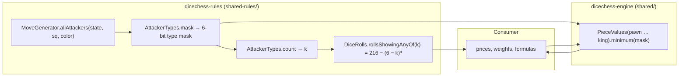

A threat in Dice Chess has two independent parts. The _geometry_ says which squares attack a target and is answered by `MoveGenerator.allAttackers`. The _dice_ say whether the mover can roll any of the attacking piece types this turn, and that depends only on which distinct **types** attack, not on how many pieces do. Every consumer that priced a hanging piece or a capture threat so far carried its own reduction from attacker squares to types, its own `1 - ((6 - k) / 6)^3` and its own "cheapest attacker" loop. [Issue #395](https://github.com/fortemate/dicechess-engine/issues/395) (part of [Epic #390](https://github.com/fortemate/dicechess-engine/issues/390)) makes those three pieces canonical. The reviewed contract is section 2.1 of [Shared Traversal & Search Contracts](/dicechess-engine/architecture/search/14-traversal-and-search-contracts/); this page is the implementation guide.

Nothing existing changed: `MoveGenerator`, `KingCaptureProbability`, `PieceSafety`, `MaterialValues`, every facade and every built-in bot keep their signatures and behaviour. All additions are binary-compatible against the previous `dicechess-rules_3` release with no MiMa exclusion.

## 1. Where each helper lives and why



- **`AttackerTypes` and the roll counts are rules facts.** Which types attack a square and how many of the 216 ordered rolls show at least one of them hold regardless of any evaluator, so they belong in `dicechess-rules_3` next to `DiceRolls` and `KingCaptureProbability`. The artifact stays stdlib-only and carries no scale or weight: the availability is an integer out of 216 (`rollsShowingAnyOf`) with a normalised `Double` twin (`probabilityOfAnyOf`), nothing more.
- **`PieceValues` is an engine helper.** "Cheapest attacker" needs prices, and prices are a consumer's policy. The engine artifact owns the _mechanism_ — the six-way minimum over the caller's own table — and ships the canonical `MaterialValues` scale only as the ready-made `PieceValues.Canonical` instance. `MaterialValues` and `PieceSafety` are unchanged.
- **The consumer keeps everything else.** Which squares it probes, what it multiplies the availability by, whether a king counts as an attacker, the sentinel it uses for "nothing attacks": all of that stays with the evaluator, and none of it is in either artifact.

## 2. The type mask

`AttackerTypes.mask(state, target, attackerColor)` returns an `Int` with one bit per piece type at `diceValue - 1`, so the mask is also the set of die faces that serve the attack:

| Bit | Type   | Die |
| --: | :----- | --: |
|   0 | Pawn   |   1 |
|   1 | Knight |   2 |
|   2 | Bishop |   3 |
|   3 | Rook   |   4 |
|   4 | Queen  |   5 |
|   5 | King   |   6 |

The layout is the one `KingCaptureProbability` already uses privately for its direct-capture die mask, and `AttackerTypes.bit(pieceType)` names it. `AttackerTypes.Empty` (`0`) and `AttackerTypes.All` (`0x3F`) are the two ends; `count`, `contains`, `availableRolls` and `availabilityProbability` read a mask back.

### The queen rule

`MoveGenerator.allAttackers` deliberately merges queens into both slider geometries — a queen on a diagonal lands in the bishop-like set, a queen on a file in the rook-like set — because for _geometry_ that is right. For _dice_ it would be wrong: only a 5 moves a queen. `AttackerTypes.mask` therefore intersects the attacker set with each exact piece-type bitboard (`state.pawns` through `state.kings`), so a diagonal queen sets only the Queen bit and never the Bishop bit. The property suite pins this against an independent mailbox scan of the attacker squares rather than against the intersection it is implemented with, and a dedicated property masks out every real bishop and rook and asserts the Bishop and Rook bits are gone.

The second overload, `AttackerTypes.mask(state, squares)`, takes any square set and reports the types of the pieces standing on it. It is the shape for a consumer that already holds an attacker bitboard (for example from a shared `allAttackers` call it also needs for a defender term) and for probing a set of victims.

The mask is a static property of the position: whose turn it is, the dice pool and whether the target is defended play no role. A defender term is the same call with the colours swapped.

## 3. Single-roll availability

With `k` distinct attacking types, an ordered roll of three dice misses all of them only when each die shows one of the other `6 - k` faces, so exactly

$$
\text{rollsShowingAnyOf}(k) = 216 - (6 - k)^3
$$

of the `DiceRolls.totalOrderedRolls` make the threat collectable:

| `k`   |   0 |   1 |   2 |   3 |   4 |   5 |   6 |
| :---- | --: | --: | --: | --: | --: | --: | --: |
| rolls |   0 |  91 | 152 | 189 | 208 | 215 | 216 |

`DiceRolls.rollsShowingAnyOf(k)` is that integer, `DiceRolls.probabilityOfAnyOf(k)` divides it by 216 once, and `AttackerTypes.availableRolls(mask)` / `availabilityProbability(mask)` apply them to `count(mask)`. Keeping the integer form public lets a consumer accumulate weights out of 216 exactly, in the same unit `ActiveDicePartitioner` and `ChanceNode` work in, and convert to a probability only at the end. The test compares every one of the 64 type subsets with an exhaustive enumeration of the 216 ordered rolls.

## 4. The minimum price over a caller's table

```scala
final case class PieceValues(pawn: Int, knight: Int, bishop: Int, rook: Int, queen: Int, king: Int)
    derives CanEqual:
  def of(pieceType: PieceType): Int
  def minimum(typeMask: Int): Option[Int]                       // None on the empty mask
  def minimumOrElse(typeMask: Int, empty: Int): Int             // allocation-free, caller's sentinel
  def minimumOn(state: GameState, squares: Bitboard, empty: Int): Int

object PieceValues:
  val Canonical: PieceValues                                   // MaterialValues as a table
```

The one rule worth stating is **every present bit is inspected**. A loop that walks the types in the familiar `P < N = B < R < Q < K` order and returns at the first present one is correct only for tables that follow that order; a consumer that prices a knight above a rook, or a queen below a bishop in some phase, would get the wrong attacker. `PieceValues` takes the least price among all present types, and the property test checks it against a plain fold over arbitrary tables, negative prices included, for all 64 masks.

`minimum` returns `None` for the empty mask. `minimumOrElse` returns the caller's own sentinel instead and allocates nothing, which is what an evaluation loop wants: a sentinel above every real price makes "nothing attacks" compare like "attacked by something unaffordable", and a king priced as such a sentinel never wins while a cheaper attacker is present but is still the answer when it attacks alone.

## 5. A generic consumer

The composition a safety-aware evaluator needs, end to end, with the consumer's own prices and its own weight:

```scala
import dicechess.engine.domain.*
import dicechess.engine.movegen.MoveGenerator
import dicechess.engine.search.{AttackerTypes, PieceSafety, PieceValues}

final class HangRisk(prices: PieceValues, weight: Double):
  /** Expected loss `side` is exposed to on its hanging pieces, weighted by whether the opponent can roll an attacker. */
  def apply(state: GameState, side: Color): Double =
    var risk      = 0.0
    var remaining = PieceSafety.hangingSquares(state, side).value
    while remaining != 0L do
      val victim = Square.fromIndex(java.lang.Long.numberOfTrailingZeros(remaining))
      val mask   = AttackerTypes.mask(state, victim, side.opponent)
      val price  = prices.of(state.mailbox(victim).pieceType)
      risk += price * AttackerTypes.availabilityProbability(mask) * weight
      remaining &= remaining - 1
    risk

  /** The cheapest piece with which `side.opponent` attacks `target`, or `empty` when nothing does. */
  def cheapestAttacker(state: GameState, target: Square, side: Color, empty: Int): Int =
    prices.minimumOn(state, MoveGenerator.allAttackers(state, target, side.opponent), empty)
```

Both helpers are pure functions of immutable inputs with no shared state, so they are safe to call from any number of search threads concurrently and return the same result for the same position on the JVM, Scala.js and WebAssembly.

## 6. Cost

Measured in the `AttackerTypesBenchmark` (`mise run bench:filter AttackerTypes`), the type mask adds six bitboard intersections to an `allAttackers` call, the availability adds one `bitCount` and a table-free cube, and `minimumOrElse` adds six compare-and-branch steps; none allocates. The benchmark reports each next to the bare `allAttackers` call on the same square so the overhead reads as a ratio on any host.

## 7. Verification

- `AttackerTypesSuite` (rules): one fixture per piece type for both colours; diagonal and orthogonal queens; a queen and a bishop on one diagonal in both orders; mixed and absent attackers; defended and undefended targets; turn and dice-pool independence; the square-set overload; the `216 - (6 - k)^3` boundaries for all `k`.
- `AttackerTypesPropertySpec` (rules): mask versus mailbox scan for every square and colour on random positions; the queen rule; `count`; exhaustive roll enumeration for all 64 type subsets; monotonicity in `k`.
- `PieceValuesSpec` (engine): canonical scale, inverted tables, the queen priced as a queen, empty-set behaviour, sentinel precedence, king as sentinel, defended target, and the fold oracle over arbitrary tables and all masks.
- `PieceValuesSpec` runs on JVM, Scala.js and Wasm; the two rules suites run on JVM and Scala.js (the Wasm project compiles the `shared/` test root only). `rulesJVM/assertRulesBinaryCompatible` passes with no exclusion; `rules-smoke` still compiles against the rules jar alone; `sbt apiDocs/doc` compiles the Scaladoc examples.
