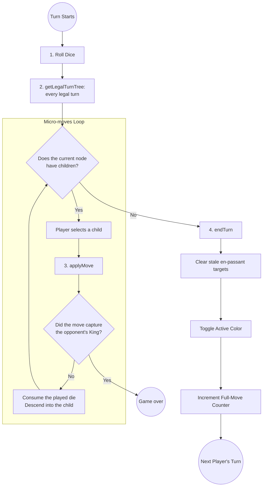

Unlike standard chess where a turn is a single, atomic action (moving one piece), a **Dice Chess** turn is an extended sequence with multiple distinct phases. This architectural choice is driven by the physical rules of the game (rolling three dice and playing up to three micro-moves).

This document outlines the conceptual lifecycle of a turn and how it maps to the Engine API and internal `GameState`.

## The Turn Lifecycle Diagram



## 1. Roll Dice (Start of Turn)

At the beginning of a turn, the active player rolls three standard 6-sided dice.
In the engine, this translates to filling the three dice slots of the `GameFlags` object.

* **DFEN Representation**: If White rolls three pawns, the 7th field of the DFEN string becomes `PPP`.
* **API Entry**: The JavaScript API takes the dice inside the DFEN, never as a separate argument. `getLegalTurnTree(dfen)` and `getLegalUciMoves(dfen)` read them from the 7th field, as in `rnbqkbnr/pppppppp/8/8/8/8/PPPPPPPP/RNBQKBNR w KQkq - 0 1 PPP`.

## 2. Generate and Filter Legal Turns

With the dice rolled, the engine calculates all pseudo-legal moves for the pieces matching the dice outcomes.
Crucially, the engine then applies the **Maximum Micro-moves Rule** (see [Maximum Micro-moves Rule Algorithm](./move-generation/05-maximum-micromoves)).

Any path that does not consume the maximum possible number of dice (or capture the King) is filtered out. Whether a micro-move is legal therefore depends on the whole turn, and the JavaScript API answers at two levels:

* `getLegalTurnTree(dfen)` returns every legal turn as a prefix tree of micro-moves. A node with no children is a complete turn; a turn that captures the King always ends at such a leaf.
* `getLegalUciMoves(dfen)` returns the legal first micro-moves, which are exactly the first level of that tree.

`getLegalUciMoves` judges the position it is given in isolation. Called again after a micro-move, it applies the rule afresh to the new position and the dice left in it, and no longer knows how many dice the whole turn could have used. The two answers agree on the first action, and can differ after it when a first action is legal only because a later one captures the King:

| Step | `getLegalUciMoves` on the current DFEN | The turn tree |
| :--- | :--- | :--- |
| Start: `8/8/8/2k5/8/1N6/2P5/K7 w - - 0 1 NPP` | `b3a5 b3c1 b3c5 b3d2 b3d4 c2c3 c2c4` | the same seven |
| After `c2c4`, dice `PN` left | `b3a5 b3c1 b3c5 b3d2 b3d4` | `b3c5` only |

After `c2c4` a quiet knight move would end a two-dice turn, while `c2c3, c3c4, Nb3xc5` spends all three dice: `c2c4` is legal only as the start of `c2c4, Nb3xc5`. A client that follows a turn one action at a time must walk the tree rather than call `getLegalUciMoves` after each micro-move.

* **En-Passant Eligibility and History**: In addition to dice consumption, en-passant captures follow strict chess rules (FIDE 3.7.4 / DiceChess.com): only pawns that were already horizontally adjacent to the opponent's pawn that double-pushed at the start of the turn are eligible to capture en-passant. Moving an eligible pawn consumes its opportunity on that branch, even when another pawn later occupies its former square. An eligible pawn that has not moved may capture on a later micro-move. Because intermediate DFENs are memoryless, evaluating an intermediate DFEN directly recomputes adjacency from the current board state and could falsely admit a pawn that arrived later in the turn. Clients must walk the prefix turn tree from the start of the turn rather than re-evaluating intermediate DFENs.

### Which dice the turn can still spend

The same rule decides which dice are still of use. `getPlayableDice(dfen, moves)` takes the rolled DFEN and the micro-moves played since, and returns the dice that at least one legal turn beginning with those moves spends after them. A client can dim the other dice: no turn left can use them.

* **A die can be playable although its piece cannot move first.** In the start position with the dice `QRN`, only a knight can move first. After `b1a3`, though, the rook can go `a1b1`, so the answer is `NR`, and only the queen die is lost. After `b1a3` it is `R`.
* **It is judged over the whole turn, from the roll.** A turn that captures the King ends at once, however many dice are left, and the DFEN after the capture does not record that. The table below shows the difference.
* **A die that is not playable stays so for the rest of the turn.** Each action only narrows the turns that can follow.
* **Most of the time no call is needed.** A client holding the tree knows that no die is playable when the current node is empty, and that every die left is playable when a path below the node has as many actions as there are dice left. It calls `getPlayableDice` only in between: with three dice, when the longest path has one or two actions.

| Step | `getPlayableDice` with the roll and the moves | Asked afresh of the current DFEN |
| :--- | :--- | :--- |
| Start: `8/8/8/2k5/8/1N6/2P5/K7 w - - 0 1 NPP` | `PPN` | `PPN` |
| After `b3c5`, which takes the King, dice `PP` left | nothing: the turn is over | `PP` |

## 3. The Micro-moves Loop (`applyMove`)

A player executes their turn incrementally.
Each time they make a move, the engine performs a **micro-move**:

* It updates the piece placements (using Bitboards and the Mailbox).
* It updates castling rights or adds a new *en-passant* target if a pawn was double-pushed.
* It removes the corresponding die from the dice pool; castling removes both the King and the Rook die. The DFEN that `applyMove` returns carries the dice that are left, and a move that no die allows is refused.

A client that walks the tree plays one of the current node's keys with `applyMove` and descends into that key's child. When the child is empty, the turn is complete. To show which of the dice left the rest of the turn can still spend, it calls `getPlayableDice` with the rolled DFEN and the moves played so far.

:::caution[Color Preservation]
During `applyMove`, the active color **does not change**. If White plays their first micro-move, the resulting state still belongs to White.
:::

## 4. Formal Turn Completion (`endTurn`)

Once the player reaches a leaf of the turn tree — the dice are spent, or no further legal micro-move exists — the turn must be explicitly terminated. A turn that captured the King ends the game instead, so no `endTurn` follows it.

The orchestrator (e.g., the PWA frontend or the Search Bot) must invoke `DiceChess.endTurn(fen)`. 
This function is responsible for the critical **state transition boundary**:

1. **Active Color Toggle**: The active color switches to the opponent (e.g., White $\rightarrow$ Black).
2. **Move Counter**: The `fullMoveNumber` increments if the completing player was Black.
3. **Stale En-Passant Cleanup**: Since a player can push multiple pawns in one turn, multiple targets can exist. Cleanup removes the incoming side's older targets: rank 6 when Black moves next, rank 3 when White moves next. The outgoing player's new targets survive for the opponent's upcoming turn. Other ranks and every surviving target bit are preserved.
4. **Dice Cleanup**: The completed turn's dice pool is cleared, including when the caller supplies a non-empty pool.
5. **Derived Hash**: The active-color and dice keys change, and precisely the expired full-target square keys are removed. Both an already populated key and a key computed on demand agree with independent recomputation.

### Immutable state construction

`GameState.endTurn()` computes cleanup and finalization before constructing one immutable state copy. It does not create an intermediate `GameState` through `clearEnPassant`; that method remains independently callable with its existing behavior. Pieces and the mailbox are reused, the half-move clock and castling rights are preserved, and the full-move number advances only after Black. The full en-passant bitboard is authoritative for cleanup; packed EP file flags keep their existing value rather than being normalized as an incidental change.

Canonical resulting-state traversal calls `endTurn()` exactly once for each normal legal turn. A king-capture result keeps the mover's active color and unfinalized counters and targets. This boundary remains the same with shared prefixes or exact evaluation memoization.

`MakeMoveBenchmark.endTurn` isolates both colors, absent/stale/mixed targets and empty/non-empty dice. `MakeMoveBenchmark.resultingTurnStates` measures normal resulting-state construction on the same target/color fixtures. Setup compares ordered paths, fields and independently recomputed hashes before timing; auxiliary result counts establish identical work. Run with `-prof gc` and normalize `normalResults` and `terminalResults` by `operations`:

```bash
sbt 'benchmark/Jmh/run -bm avgt -prof gc .*MakeMoveBenchmark.(endTurn|resultingTurnStates).*'
```

Keep comparative time/allocation measurements in the private knowledge base under **Turn-finalization construction performance qualification**. This measures immutable-state construction and fixed-work parity, not playing strength.
